# Consolidated Schema Design & Entity-Relationship Model (PR P2-00)

**Document Reference:** `docs/decisions/schema-design.md`  
**Phase:** Phase 2 — Data Model and Financial Foundations  
**Target Pull Request:** P2-00 (Documentation Only)  
**Specification Baseline:** Revision 2 Implementation Guide (§1, §2, §3.1, §4, Appendices A–C)  

---

## 1. Executive Summary & Architectural Invariants

This design consolidates the complete financial data model for Crystal Kairos before individual implementation PRs alter the schema piecemeal. It replaces the legacy prototype schema (`Transaction`, legacy `EAjo`, `AjoFeeConfig`, `LoanSettings` singleton) with an immutable double-entry ledger, explicit schedule persistence, granular payment allocation, and formal case management.

### Non-Negotiable Data Invariants
1. **Financial Immutability & Referential Integrity:**
   - All relations touching money, obligations, or ledger lines use `onDelete: Restrict`.
   - No financial record may ever `Cascade` delete or `SetNull`.
   - Operational balances are cached views derived transactionally from immutable posted records.
2. **Precision & Types:**
   - All monetary amount columns are explicitly `@db.Decimal(15, 2)`.
   - All interest rates, penalty percentages, and slot penalty rates are explicitly `@db.Decimal(7, 4)`.
   - Never use floating point numbers in financial tables.
3. **Africa/Lagos Calendar Days (`@db.Date`):**
   - Calendar-day fields (`dueDate`, `valueDate`, `paidOn`, `startDate`, `maturityDate`, `effectiveDate`, `penaltyDate`, `accrualDate`, `noticeDeadlineDate`) are strictly stored as `DateTime @db.Date`.
   - UTC timestamps (`DateTime @default(now())`) are used solely for point-in-time instants (`createdAt`, `submittedAt`, `confirmedAt`, `postedAt`).
4. **Idempotency Keys:**
   - Every state-altering financial operation (payment submission, confirmation, allocation, reversal, ledger journal entry, penalty accrual, recovery attempt, wallet withdrawal) has a unique idempotency constraint.
5. **Staff Are Never Members (D-15):**
   - Users with role `OWNER` or `ADMIN` can never hold a `Membership`, savings plan, loan, e-ajo slot, guarantee, or wallet.

---

## 2. Comprehensive Entity-Relationship Diagram (ERD)

```mermaid
erDiagram
    User ||--o| UserInfo : "has"
    User ||--o| Membership : "holds"
    User ||--o{ BankAccount : "registers"
    User ||--o| NextOfKin : "designates"
    User ||--o{ UserSession : "establishes"
    User ||--o{ LoginAttempt : "logs"
    User ||--o{ PasswordSetupToken : "receives"
    User ||--o{ AdminPermissionGrant : "granted"
    User ||--o{ PrivacyConsent : "consents"
    User ||--o{ StoredFile : "uploads"
    User ||--o{ ProfileChangeRequest : "submits"

    User ||--o{ Savings : "owns"
    User ||--o{ Loan : "borrows"
    User ||--o{ EAjoMember : "participates"
    User ||--o{ GuaranteeRequest : "requests_or_guarantees"
    User ||--o{ PaymentSubmission : "submits"
    User ||--o{ Payment : "confirmed_for"
    User ||--o{ WalletWithdrawal : "withdraws"
    User ||--o{ RecoveryCase : "debtor_in"
    User ||--o| MemberSettlementCase : "settles"

    SocietyBankAccount ||--o{ PaymentSubmission : "receives_into"
    SavingsProduct ||--o{ SavingsProductTermRate : "configures"
    SavingsProduct ||--o{ Savings : "instantiates"

    Savings ||--o{ SavingsPeriod : "schedules"
    Savings ||--o{ SavingsLot : "tracks_principal"
    SavingsLot ||--o{ SavingsInterestAccrual : "accrues_monthly"

    Loan ||--o{ LoanInstalment : "schedules"
    LoanInstalment ||--o{ LoanPenaltyAccrual : "accrues_daily"
    Loan ||--o{ GuaranteeRequest : "backed_by"

    EAjoGroup ||--o{ EAjoSlotPolicy : "configures"
    EAjoGroup ||--o{ EAjoMember : "enrolls"
    EAjoMember ||--o{ EAjoContributionPeriod : "schedules"
    EAjoMember ||--o| EAjoPayout : "entitled_to"
    EAjoContributionPeriod ||--o{ EAjoPenaltyAccrual : "accrues_daily"

    GuaranteeRequest ||--o{ GuaranteeReservation : "reserves"

    PaymentSubmission ||--o{ SubmissionTarget : "targets"
    PaymentSubmission ||--o| Payment : "generates"
    Payment ||--o{ PaymentAllocation : "allocates"

    JournalEntry ||--o{ JournalLine : "contains"
    JournalEntry ||--o| JournalEntry : "reverses"
    PaymentAllocation ||--o| JournalEntry : "posts"
    Disbursement ||--o| JournalEntry : "posts"

    RecoveryCase ||--o{ RecoveryAction : "executes"
    MemberSettlementCase ||--o{ SettlementContactLog : "records"
    MemberSettlementCase ||--o{ SettlementPayee : "distributes_to"
```



---

## 3. Detailed Model Inventory

### 3.1 Domain: Identity, Security & Access Control

#### 3.1.1 `User`
Primary identity entity for members and staff.
- **Fields:**
  - `id`: `String` `@id @default(uuid())`
  - `email`: `String` `@unique`
  - `username`: `String` `@unique @default(uuid())`
  - `name`: `String`
  - `passwordHash`: `String?`
  - `photoUrl`: `String?`
  - `role`: `UserRole` `@default(USER)` (`OWNER`, `ADMIN`, `USER`)
  - `emailVerified`: `DateTime?`
  - `hasSetPassword`: `Boolean` `@default(false)`
  - `sessionVersion`: `Int` `@default(0)`
  - `isActive`: `Boolean` `@default(true)`
  - `deactivationReason`: `UserDeactivationReason?` (`ADMIN_ACTION`, `EXITED`, `DECEASED`, `OTHER`)
  - `deactivatedAt`: `DateTime?`
  - `deactivatedById`: `String?`
  - `lastLoginAt`: `DateTime?`
  - `mfaEnabled`: `Boolean` `@default(false)`
  - `mfaSecret`: `String?` (Encrypted AES-256-GCM)
  - `mfaBackupCodes`: `Json?` (Array of hashed codes)
  - `mfaEnrolledAt`: `DateTime?`
  - `mfaResetAt`: `DateTime?`
  - `lockedUntil`: `DateTime?`
  - `lockoutCount`: `Int` `@default(0)`
  - `createdAt`: `DateTime @default(now())`
  - `updatedAt`: `DateTime @updatedAt`
- **Relations:**
  - `deactivatedBy`: `User?` (`onDelete: Restrict`)
  - `membership`: `Membership?` (`onDelete: Restrict`)
  - `userInfo`: `UserInfo?` (`onDelete: Restrict`)
  - `bankAccounts`: `BankAccount[]` (`onDelete: Restrict`)
  - `nextOfKin`: `NextOfKin?` (`onDelete: Restrict`)
  - `savings`: `Savings[]` (`onDelete: Restrict`)
  - `loans`: `Loan[]` (`onDelete: Restrict`)
  - `eAjoMembers`: `EAjoMember[]` (`onDelete: Restrict`)
  - `userSessions`: `UserSession[]` (`onDelete: Cascade`)
  - `loginAttempts`: `LoginAttempt[]` (`onDelete: Cascade`)
  - `passwordSetupTokens`: `PasswordSetupToken[]` (`onDelete: Cascade`)
  - `adminPermissionGrants`: `AdminPermissionGrant[]` (`onDelete: Restrict`)
  - `privacyConsents`: `PrivacyConsent[]` (`onDelete: Restrict`)
- **Indexes:** `[email]`, `[role, isActive]`, `[lockedUntil]`

#### 3.1.2 `UserSession`
Revocable, idle-timeout-aware session store.
- **Fields:**
  - `id`: `String @id @default(uuid())`
  - `userId`: `String`
  - `createdAt`: `DateTime @default(now())`
  - `lastSeenAt`: `DateTime @default(now())`
  - `expiresAt`: `DateTime`
  - `idleExpiresAt`: `DateTime`
  - `userAgentLabel`: `String?`
  - `ipHash`: `String?`
  - `mfaVerifiedAt`: `DateTime?`
  - `revokedAt`: `DateTime?`
- **Relations:** `user`: `User` (`onDelete: Cascade`)
- **Indexes:** `[userId, revokedAt, expiresAt]`, `[expiresAt]`

#### 3.1.3 `LoginAttempt`
Rate-limiting and credential stuffing audit record.
- **Fields:**
  - `id`: `String @id @default(uuid())`
  - `userId`: `String?`
  - `emailHash`: `String`
  - `ipHash`: `String`
  - `succeeded`: `Boolean`
  - `createdAt`: `DateTime @default(now())`
- **Relations:** `user`: `User?` (`onDelete: Cascade`)
- **Indexes:** `[emailHash, createdAt]`, `[ipHash, createdAt]`

#### 3.1.4 `PasswordSetupToken`
Cryptographically secure activation and reset token store.
- **Fields:**
  - `id`: `String @id @default(uuid())`
  - `userId`: `String`
  - `tokenHash`: `String @unique`
  - `purpose`: `PasswordSetupTokenPurpose` (`SET_PASSWORD`, `RESET_PASSWORD`)
  - `expiresAt`: `DateTime`
  - `usedAt`: `DateTime?`
  - `requestedIp`: `String?`
  - `createdById`: `String?`
  - `createdAt`: `DateTime @default(now())`
- **Relations:** `user`: `User` (`onDelete: Cascade`), `createdBy`: `User?` (`onDelete: SetNull`)
- **Indexes:** `[userId, purpose, createdAt]`, `[requestedIp, createdAt]`, `[expiresAt]`

#### 3.1.5 `AdminPermissionGrant`
Granular owner-assigned permission matrix for administrators.
- **Fields:**
  - `id`: `String @id @default(uuid())`
  - `adminUserId`: `String`
  - `permission`: `AdminPermission` (31 distinct permissions)
  - `grantedById`: `String`
  - `createdAt`: `DateTime @default(now())`
- **Unique Constraint:** `@@unique([adminUserId, permission])`
- **Relations:** `admin`: `User` (`onDelete: Restrict`), `grantedBy`: `User` (`onDelete: Restrict`)

#### 3.1.6 `PrivacyConsent`
Data-protection consent compliance baseline (§1.10, D-21).
- **Fields:**
  - `id`: `String @id @default(uuid())`
  - `userId`: `String`
  - `noticeVersion`: `String`
  - `acceptedAt`: `DateTime @default(now())`
  - `ipHash`: `String?`
  - `userAgent`: `String?`
- **Unique Constraint:** `@@unique([userId, noticeVersion])`
- **Relations:** `user`: `User` (`onDelete: Restrict`)

---

### 3.2 Domain: Member Profile & Verification

#### 3.2.1 `Membership`
Formal cooperative membership status and sequencing.
- **Fields:**
  - `id`: `String @id @default(uuid())`
  - `userId`: `String @unique`
  - `memberNumber`: `String? @unique` (Format `CK-000001` from PostgreSQL sequence)
  - `status`: `MembershipStatus` `@default(PENDING)` (`PENDING`, `APPROVED`, `REJECTED`, `EXPIRED`)
  - `interests`: `MembershipInterest[]`
  - `sourceOfIncome`: `String[]`
  - `referralName`: `String?`
  - `referralPhoneNumber`: `String?`
  - `approvedAt`: `DateTime?`
  - `approvedById`: `String?`
  - `rejectionReason`: `String?`
  - `membershipFee`: `Decimal @default(0) @db.Decimal(15, 2)`
  - `renewalFee`: `Decimal @default(0) @db.Decimal(15, 2)` (Unused D-19)
  - `expiryDate`: `DateTime? @db.Date` (Unused D-19)
  - `lastRenewalDate`: `DateTime? @db.Date` (Unused D-19)
  - `createdAt`: `DateTime @default(now())`
  - `updatedAt`: `DateTime @updatedAt`
- **Relations:** `user`: `User` (`onDelete: Restrict`), `approvedBy`: `User?` (`onDelete: Restrict`)
- **Indexes:** `[status]`, `[memberNumber]`

#### 3.2.2 `UserInfo`
Personal biodata and contact information.
- **Fields:**
  - `id`: `String @id @default(uuid())`
  - `userId`: `String @unique`
  - `address`: `String?`
  - `dateOfBirth`: `DateTime? @db.Date`
  - `gender`: `Gender?` (`MALE`, `FEMALE`)
  - `occupation`: `String?`
  - `phoneNumber`: `String? @unique` (E.164 normalised; unique across active members A-22)
  - `createdAt`: `DateTime @default(now())`
  - `updatedAt`: `DateTime @updatedAt`
- **Relations:** `user`: `User` (`onDelete: Restrict`)

#### 3.2.3 `BankAccount`
Member's verified external bank account for receiving payouts and withdrawals.
- **Fields:**
  - `id`: `String @id @default(uuid())`
  - `userId`: `String`
  - `bankCode`: `String`
  - `bankName`: `String`
  - `accountNumber`: `String`
  - `accountName`: `String`
  - `isPrimary`: `Boolean @default(false)`
  - `isVerified`: `Boolean @default(false)`
  - `verifiedAt`: `DateTime?`
  - `createdAt`: `DateTime @default(now())`
  - `updatedAt`: `DateTime @updatedAt`
- **Unique Constraint:** `@@unique([bankCode, accountNumber])` (Unique across active members; owner override logged A-22)
- **Relations:** `user`: `User` (`onDelete: Restrict`)
- **Indexes:** `[userId, isPrimary]`

#### 3.2.4 `NextOfKin`
Next of kin contact for settlement in the event of death.
- **Fields:**
  - `id`: `String @id @default(uuid())`
  - `userId`: `String @unique`
  - `name`: `String`
  - `phoneNumber`: `String`
  - `relationship`: `Relationship`
  - `bankName`: `String?`
  - `accountNumber`: `String?`
  - `accountName`: `String?`
  - `occupation`: `String?`
  - `address`: `String?`
  - `createdAt`: `DateTime @default(now())`
  - `updatedAt`: `DateTime @updatedAt`
- **Relations:** `user`: `User` (`onDelete: Restrict`)

#### 3.2.5 `ProfileChangeRequest`
Audited review queue for sensitive profile amendments.
- **Fields:**
  - `id`: `String @id @default(uuid())`
  - `userId`: `String`
  - `fieldName`: `String` (e.g. `bankAccount`, `phoneNumber`, `name`)
  - `oldValue`: `Json?`
  - `requestedValue`: `Json`
  - `reason`: `String?`
  - `status`: `ProfileChangeStatus` (`PENDING`, `APPROVED`, `REJECTED`)
  - `reviewedById`: `String?`
  - `reviewedAt`: `DateTime?`
  - `rejectionReason`: `String?`
  - `createdAt`: `DateTime @default(now())`
- **Relations:** `user`: `User` (`onDelete: Restrict`), `reviewedBy`: `User?` (`onDelete: Restrict`)
- **Indexes:** `[userId, status]`

---

### 3.3 Domain: Society Configuration & Pricing

#### 3.3.1 `SocietyBankAccount`
Receiving bank account information shown to members for offline bank transfers.
- **Fields:**
  - `id`: `String @id @default(uuid())`
  - `bankCode`: `String?`
  - `bankName`: `String`
  - `accountNumber`: `String`
  - `accountName`: `String`
  - `isActive`: `Boolean @default(false)`
  - `createdById`: `String`
  - `createdAt`: `DateTime @default(now())`
  - `updatedAt`: `DateTime @updatedAt`
- **Relations:** `createdBy`: `User` (`onDelete: Restrict`)
- **Indexes:** `[isActive]`

#### 3.3.2 `SocietySetting`
Centralised key-value system configuration store.
- **Fields:**
  - `key`: `String @id`
  - `value`: `Json`
  - `updatedById`: `String?`
  - `updatedAt`: `DateTime @updatedAt`
- **Relations:** `updatedBy`: `User?` (`onDelete: Restrict`)

#### 3.3.3 `LoanTermRate`
Admin-configured loan pricing per term duration (1 to 12 months).
- **Fields:**
  - `id`: `String @id @default(uuid())`
  - `durationMonths`: `Int` (1 to 12)
  - `monthlyInterestRatePercent`: `Decimal @db.Decimal(7, 4)`
  - `latePenaltyDailyPercent`: `Decimal @db.Decimal(7, 4)`
  - `penaltyCapType`: `PenaltyCapType` (`PERCENT_OF_PRINCIPAL`, `FIXED_AMOUNT`)
  - `penaltyCapValue`: `Decimal @db.Decimal(15, 2)`
  - `applicationFee`: `Decimal @default(0) @db.Decimal(15, 2)`
  - `version`: `Int @default(1)`
  - `isActive`: `Boolean @default(true)`
  - `createdById`: `String`
  - `createdAt`: `DateTime @default(now())`
- **Unique Constraint:** `@@unique([durationMonths, version])`
- **Relations:** `createdBy`: `User` (`onDelete: Restrict`)

#### 3.3.4 `SavingsProduct`
Product catalogue for Fixed, Regular, and Staggered savings plans.
- **Fields:**
  - `id`: `String @id @default(uuid())`
  - `type`: `SavingsType` (`FIXED`, `REGULAR`, `STAGGERED`)
  - `title`: `String`
  - `description`: `String`
  - `badge`: `String?`
  - `icon`: `String`
  - `isActive`: `Boolean @default(true)`
  - `createdById`: `String`
  - `createdAt`: `DateTime @default(now())`
  - `updatedAt`: `DateTime @updatedAt`
- **Relations:** `createdBy`: `User` (`onDelete: Restrict`), `termRates`: `SavingsProductTermRate[]`

#### 3.3.5 `SavingsProductTermRate`
Term-specific interest rates for savings products (1 to 12 months).
- **Fields:**
  - `id`: `String @id @default(uuid())`
  - `savingsProductId`: `String`
  - `durationMonths`: `Int` (1 to 12)
  - `termRatePercent`: `Decimal @db.Decimal(7, 4)` (Full-term simple interest)
  - `version`: `Int @default(1)`
  - `isActive`: `Boolean @default(true)`
  - `createdAt`: `DateTime @default(now())`
- **Unique Constraint:** `@@unique([savingsProductId, durationMonths, version])`
- **Relations:** `savingsProduct`: `SavingsProduct` (`onDelete: Restrict`)

#### 3.3.6 `EAjoGroup`
Admin-created collaborative contribution cycle.
- **Fields:**
  - `id`: `String @id @default(uuid())`
  - `title`: `String`
  - `description`: `String?`
  - `contributionAmount`: `Decimal @db.Decimal(15, 2)`
  - `frequency`: `EAjoFrequency` (`MONTHLY`)
  - `durationMonths`: `Int` (4, 6, 12)
  - `totalSlots`: `Int` (Equals `durationMonths`)
  - `filledSlots`: `Int @default(0)`
  - `maxMembersPerSlot`: `Int?` (null = unlimited)
  - `latePenaltyDailyPercent`: `Decimal @db.Decimal(7, 4)`
  - `penaltyCapType`: `PenaltyCapType`
  - `penaltyCapValue`: `Decimal @db.Decimal(15, 2)`
  - `status`: `EAjoStatus` (`PENDING`, `ACTIVE`, `COMPLETED`, `CANCELLED`)
  - `startDate`: `DateTime? @db.Date`
  - `endDate`: `DateTime? @db.Date`
  - `createdById`: `String`
  - `createdAt`: `DateTime @default(now())`
  - `updatedAt`: `DateTime @updatedAt`
- **Relations:** `createdBy`: `User` (`onDelete: Restrict`), `slotPolicies`: `EAjoSlotPolicy[]`, `members`: `EAjoMember[]`

#### 3.3.7 `EAjoSlotPolicy`
Slot-specific early collection discount/penalty configuration.
- **Fields:**
  - `id`: `String @id @default(uuid())`
  - `groupId`: `String`
  - `slotNumber`: `Int` (1 to `totalSlots`)
  - `earlySlotPenaltyPercent`: `Decimal @db.Decimal(7, 4)`
- **Unique Constraint:** `@@unique([groupId, slotNumber])`
- **Relations:** `group`: `EAjoGroup` (`onDelete: Restrict`)

#### 3.3.8 `PolicyUpdateDraft`
Audited draft communication for admin rate adjustments (§4.5, P4-07).
- **Fields:**
  - `id`: `String @id @default(uuid())`
  - `productType`: `String`
  - `title`: `String`
  - `summary`: `String`
  - `content`: `String`
  - `effectiveDate`: `DateTime @db.Date`
  - `status`: `PolicyUpdateDraftStatus` (`DRAFT`, `SENT`, `DISCARDED`)
  - `createdById`: `String`
  - `sentAt`: `DateTime?`
  - `createdAt`: `DateTime @default(now())`
- **Relations:** `createdBy`: `User` (`onDelete: Restrict`)

---

### 3.4 Domain: Payments, Allocation & Money-Out

#### 3.4.1 `PaymentSubmission`
Member receipt upload record representing an unverified claim of payment.
- **Fields:**
  - `id`: `String @id @default(uuid())`
  - `submissionNumber`: `String @unique` (e.g. `SUB-000001`)
  - `memberId`: `String`
  - `receivingBankAccountId`: `String?`
  - `claimedAmount`: `Decimal @db.Decimal(15, 2)`
  - `paidOn`: `DateTime @db.Date` (Claimed Lagos payment date)
  - `bankReference`: `String?`
  - `receiptFileId`: `String`
  - `fileHash`: `String`
  - `narration`: `String?`
  - `status`: `PaymentSubmissionStatus` (`SUBMITTED`, `CONFIRMED`, `REJECTED`, `CANCELLED`)
  - `rejectionReason`: `String?`
  - `resubmissionOfId`: `String?`
  - `submittedAt`: `DateTime @default(now())`
  - `confirmedAt`: `DateTime?`
  - `confirmedById`: `String?`
  - `valueDate`: `DateTime? @db.Date` (Verified bank value date)
- **Relations:**
  - `member`: `User` (`onDelete: Restrict`)
  - `receivingBankAccount`: `SocietyBankAccount?` (`onDelete: Restrict`)
  - `receiptFile`: `StoredFile` (`onDelete: Restrict`)
  - `confirmedBy`: `User?` (`onDelete: Restrict`)
  - `resubmissionOf`: `PaymentSubmission?` (`onDelete: Restrict`)
  - `targets`: `SubmissionTarget[]`
  - `payment`: `Payment?`
- **Indexes:** `[memberId, status]`, `[paidOn]`, `[fileHash]`, `[bankReference]`

#### 3.4.2 `SubmissionTarget`
Member-specified intention for allocating the submitted amount across periods.
- **Fields:**
  - `id`: `String @id @default(uuid())`
  - `submissionId`: `String`
  - `targetType`: `AllocationTargetType` (`SAVINGS`, `LOAN`, `EAJO`, `WALLET`, `FEE`)
  - `targetId`: `String`
  - `targetPeriodId`: `String?`
  - `requestedAmount`: `Decimal @db.Decimal(15, 2)`
- **Relations:** `submission`: `PaymentSubmission` (`onDelete: Cascade`)
- **Indexes:** `[submissionId]`, `[targetType, targetId]`

#### 3.4.3 `Payment`
Confirmed bank deposit record verifying actual cash receipt by the cooperative.
- **Fields:**
  - `id`: `String @id @default(uuid())`
  - `paymentNumber`: `String @unique` (e.g. `PAY-000001`)
  - `submissionId`: `String? @unique`
  - `memberId`: `String`
  - `totalConfirmedAmount`: `Decimal @db.Decimal(15, 2)`
  - `valueDate`: `DateTime @db.Date` (Authoritative Lagos date for lateness & interest)
  - `status`: `PaymentStatus` (`CONFIRMED`, `REVERSED`)
  - `confirmedAt`: `DateTime @default(now())`
  - `confirmedById`: `String`
  - `reversedAt`: `DateTime?`
  - `reversedById`: `String?`
  - `reversalReason`: `String?`
  - `idempotencyKey`: `String @unique`
- **Relations:**
  - `submission`: `PaymentSubmission?` (`onDelete: Restrict`)
  - `member`: `User` (`onDelete: Restrict`)
  - `confirmedBy`: `User` (`onDelete: Restrict`)
  - `reversedBy`: `User?` (`onDelete: Restrict`)
  - `allocations`: `PaymentAllocation[]`
- **Indexes:** `[memberId, valueDate]`, `[valueDate]`, `[status]`

#### 3.4.4 `PaymentAllocation`
Granular record mapping each confirmed naira to an obligation or wallet credit.
- **Fields:**
  - `id`: `String @id @default(uuid())`
  - `paymentId`: `String`
  - `targetType`: `AllocationTargetType` (`SAVINGS`, `LOAN`, `EAJO`, `WALLET`, `FEE`)
  - `targetId`: `String`
  - `periodId`: `String?`
  - `componentType`: `PaymentComponentType` (`PENALTY`, `INTEREST`, `PRINCIPAL`, `CONTRIBUTION`, `WALLET_TOPUP`, `FEE`)
  - `amount`: `Decimal @db.Decimal(15, 2)`
  - `status`: `AllocationStatus` (`ACTIVE`, `REVERSED`)
  - `reversedAt`: `DateTime?`
  - `journalEntryId`: `String?`
  - `createdAt`: `DateTime @default(now())`
- **Relations:**
  - `payment`: `Payment` (`onDelete: Restrict`)
  - `journalEntry`: `JournalEntry?` (`onDelete: Restrict`)
- **Indexes:** `[paymentId]`, `[targetType, targetId, periodId]`, `[status]`

#### 3.4.5 `Disbursement`
Audit and execution record for money paid out of cooperative cash (§1.4, §1.5, §2.11).
- **Fields:**
  - `id`: `String @id @default(uuid())`
  - `disbursementNumber`: `String @unique` (e.g. `DSB-000001`)
  - `recipientUserId`: `String`
  - `purpose`: `DisbursementPurpose` (`LOAN_DISBURSEMENT`, `SAVINGS_PAYOUT`, `EAJO_PAYOUT`, `WALLET_WITHDRAWAL`, `MEMBER_SETTLEMENT`)
  - `amount`: `Decimal @db.Decimal(15, 2)`
  - `bankAccountId`: `String`
  - `bankReference`: `String?`
  - `valueDate`: `DateTime @db.Date`
  - `status`: `DisbursementStatus` (`REQUESTED`, `APPROVED`, `PAID`, `FAILED`, `CANCELLED`)
  - `requestedById`: `String`
  - `approvedById`: `String?`
  - `disbursedById`: `String?`
  - `disbursedAt`: `DateTime?`
  - `rejectionReason`: `String?`
  - `journalEntryId`: `String?`
  - `idempotencyKey`: `String @unique`
  - `createdAt`: `DateTime @default(now())`
- **Relations:**
  - `recipient`: `User` (`onDelete: Restrict`)
  - `bankAccount`: `BankAccount` (`onDelete: Restrict`)
  - `requestedBy`: `User` (`onDelete: Restrict`)
  - `approvedBy`: `User?` (`onDelete: Restrict`)
  - `disbursedBy`: `User?` (`onDelete: Restrict`)
  - `journalEntry`: `JournalEntry?` (`onDelete: Restrict`)
- **Indexes:** `[recipientUserId, status]`, `[valueDate]`

#### 3.4.6 `FeeAssessment`
Application and administrative fee obligations (§1.9).
- **Fields:**
  - `id`: `String @id @default(uuid())`
  - `memberId`: `String`
  - `feeType`: `FeeType` (`LOAN_APPLICATION`, `MEMBERSHIP`)
  - `targetId`: `String` (e.g. loan application ID)
  - `amount`: `Decimal @db.Decimal(15, 2)`
  - `status`: `FeeStatus` (`PENDING`, `PAID`, `WAIVED`)
  - `paymentAllocationId`: `String?`
  - `assessedAt`: `DateTime @default(now())`
- **Relations:**
  - `member`: `User` (`onDelete: Restrict`)
  - `allocation`: `PaymentAllocation?` (`onDelete: Restrict`)
- **Indexes:** `[memberId, status]`, `[feeType, targetId]`

#### 3.4.7 `UnidentifiedDeposit`
Suspense account intake for bank credits missing a matching member reference (§1.2, P3-10).
- **Fields:**
  - `id`: `String @id @default(uuid())`
  - `reference`: `String @unique`
  - `societyBankAccountId`: `String`
  - `amount`: `Decimal @db.Decimal(15, 2)`
  - `receivedDate`: `DateTime @db.Date`
  - `narration`: `String?`
  - `status`: `UnidentifiedDepositStatus` (`UNMATCHED`, `ASSIGNED`, `REFUNDED`)
  - `assignedMemberId`: `String?`
  - `paymentId`: `String?`
  - `assignedById`: `String?`
  - `assignedAt`: `DateTime?`
  - `createdAt`: `DateTime @default(now())`
- **Relations:**
  - `societyBankAccount`: `SocietyBankAccount` (`onDelete: Restrict`)
  - `assignedMember`: `User?` (`onDelete: Restrict`)
  - `payment`: `Payment?` (`onDelete: Restrict`)
  - `assignedBy`: `User?` (`onDelete: Restrict`)
- **Indexes:** `[status]`, `[receivedDate]`

#### 3.4.8 `BankReconciliation`
Monthly physical statement balance audit log.
- **Fields:**
  - `id`: `String @id @default(uuid())`
  - `societyBankAccountId`: `String`
  - `statementDate`: `DateTime @db.Date`
  - `closingBalance`: `Decimal @db.Decimal(15, 2)`
  - `reconciledById`: `String`
  - `reconciledAt`: `DateTime @default(now())`
  - `notes`: `String?`
- **Unique Constraint:** `@@unique([societyBankAccountId, statementDate])`
- **Relations:**
  - `societyBankAccount`: `SocietyBankAccount` (`onDelete: Restrict`)
  - `reconciledBy`: `User` (`onDelete: Restrict`)

---

### 3.5 Domain: Double-Entry Financial Ledger

#### 3.5.1 `JournalEntry`
Immutable header for balanced double-entry accounting records (§2.12).
- **Fields:**
  - `id`: `String @id @default(uuid())`
  - `sourceType`: `String` (e.g. `PAYMENT`, `DISBURSEMENT`, `RECOVERY`, `ACCRUAL`)
  - `sourceId`: `String`
  - `idempotencyKey`: `String @unique`
  - `description`: `String`
  - `effectiveDate`: `DateTime @db.Date` (Lagos value date)
  - `postedAt`: `DateTime @default(now())`
  - `postedById`: `String?` (null for automated background jobs)
  - `reversalOfId`: `String? @unique`
  - `reason`: `String?`
  - `createdAt`: `DateTime @default(now())`
- **Relations:**
  - `postedBy`: `User?` (`onDelete: Restrict`)
  - `reversalOf`: `JournalEntry?` (`relation("JournalReversal", fields: [reversalOfId], references: [id], onDelete: Restrict)`)
  - `reversedBy`: `JournalEntry?` (`relation("JournalReversal")`)
  - `lines`: `JournalLine[]`
- **Indexes:** `[sourceType, sourceId]`, `[effectiveDate]`, `[postedAt]`

#### 3.5.2 `JournalLine`
Debits and credits belonging to a posted journal entry.
- **Fields:**
  - `id`: `String @id @default(uuid())`
  - `journalEntryId`: `String`
  - `accountType`: `LedgerAccountType` (22 accounts in §2.12)
  - `memberId`: `String?` (For sub-ledger member balances)
  - `accountRefType`: `String?` (`SAVINGS`, `LOAN`, `EAJO_MEMBER`, `WALLET`, etc.)
  - `accountRefId`: `String?`
  - `currency`: `String @default("NGN")`
  - `debit`: `Decimal @default(0) @db.Decimal(15, 2)`
  - `credit`: `Decimal @default(0) @db.Decimal(15, 2)`
  - `createdAt`: `DateTime @default(now())`
- **Relations:**
  - `journalEntry`: `JournalEntry` (`onDelete: Restrict`)
  - `member`: `User?` (`onDelete: Restrict`)
- **Indexes:** `[accountType, accountRefId]`, `[memberId, accountType]`, `[journalEntryId]`

#### 3.5.3 `WalletWithdrawal`
Member-initiated wallet cash-out request acting as an active balance hold (§2.11, P3-08).
- **Fields:**
  - `id`: `String @id @default(uuid())`
  - `withdrawalNumber`: `String @unique` (e.g. `WTH-000001`)
  - `memberId`: `String`
  - `amount`: `Decimal @db.Decimal(15, 2)`
  - `bankAccountId`: `String`
  - `status`: `WalletWithdrawalStatus` (`REQUESTED`, `APPROVED`, `PAID`, `REJECTED`, `CANCELLED`, `FAILED`)
  - `requestedAt`: `DateTime @default(now())`
  - `approvedById`: `String?`
  - `approvedAt`: `DateTime?`
  - `disbursementId`: `String? @unique`
  - `rejectionReason`: `String?`
  - `idempotencyKey`: `String @unique`
- **Relations:**
  - `member`: `User` (`onDelete: Restrict`)
  - `bankAccount`: `BankAccount` (`onDelete: Restrict`)
  - `approvedBy`: `User?` (`onDelete: Restrict`)
  - `disbursement`: `Disbursement?` (`onDelete: Restrict`)
- **Indexes:** `[memberId, status]`

---

### 3.6 Domain: Savings Architecture

#### 3.6.1 `Savings`
Member's subscribed savings plan contract.
- **Fields:**
  - `id`: `String @id @default(uuid())`
  - `userId`: `String`
  - `productId`: `String`
  - `savingsType`: `SavingsType` (`FIXED`, `REGULAR`, `STAGGERED`)
  - `durationMonths`: `Int` (1 to 12)
  - `termRatePercent`: `Decimal @db.Decimal(7, 4)` (Snapshotted full-term rate)
  - `targetAmount`: `Decimal? @db.Decimal(15, 2)`
  - `status`: `SavingsStatus` (`PENDING`, `ACTIVE`, `MATURED`, `WITHDRAWAL_PENDING`, `WITHDRAWN`, `CANCELLED`)
  - `startDate`: `DateTime? @db.Date` (Value date of first confirmed deposit D-08)
  - `maturityDate`: `DateTime? @db.Date` (`addMonthsClamped(startDate, durationMonths)`)
  - `earlyWithdrawnAt`: `DateTime?`
  - `withdrawnAt`: `DateTime?`
  - `createdAt`: `DateTime @default(now())`
  - `updatedAt`: `DateTime @updatedAt`
- **Relations:**
  - `user`: `User` (`onDelete: Restrict`)
  - `product`: `SavingsProduct` (`onDelete: Restrict`)
  - `periods`: `SavingsPeriod[]`
  - `lots`: `SavingsLot[]`
- **Indexes:** `[userId, status]`, `[status, maturityDate]`

#### 3.6.2 `SavingsPeriod`
Persisted regular-savings scheduled contribution instalment (§1.3, §2.6).
- **Fields:**
  - `id`: `String @id @default(uuid())`
  - `savingsId`: `String`
  - `periodNumber`: `Int` (1 to `durationMonths`)
  - `dueDate`: `DateTime @db.Date` (`addMonthsClamped(startDate, periodNumber - 1)`)
  - `expectedAmount`: `Decimal @db.Decimal(15, 2)`
  - `paidAmount`: `Decimal @default(0) @db.Decimal(15, 2)`
  - `status`: `PeriodStatus` (`PENDING`, `IN_REVIEW`, `COMPLETED`, `ONGOING`, `OVERDUE`, `WAIVED`)
  - `interestForfeited`: `Boolean @default(false)` (True if unpaid past day +8 grace)
  - `forfeitedAt`: `DateTime?`
  - `shieldedUntil`: `DateTime?`
- **Unique Constraint:** `@@unique([savingsId, periodNumber])`
- **Relations:** `savings`: `Savings` (`onDelete: Restrict`), `lots`: `SavingsLot[]`
- **Indexes:** `[dueDate, status]`

#### 3.6.3 `SavingsLot`
Immutable principal tranche representing a single confirmed deposit allocation (§2.5).
- **Fields:**
  - `id`: `String @id @default(uuid())`
  - `savingsId`: `String`
  - `savingsPeriodId`: `String?`
  - `paymentAllocationId`: `String @unique`
  - `amount`: `Decimal @db.Decimal(15, 2)`
  - `valueDate`: `DateTime @db.Date` (Lagos deposit value date)
  - `isInterestBearing`: `Boolean @default(true)`
  - `status`: `LotStatus` (`ACTIVE`, `VOIDED`, `WITHDRAWN`)
  - `createdAt`: `DateTime @default(now())`
- **Relations:**
  - `savings`: `Savings` (`onDelete: Restrict`)
  - `savingsPeriod`: `SavingsPeriod?` (`onDelete: Restrict`)
  - `allocation`: `PaymentAllocation` (`onDelete: Restrict`)
  - `accruals`: `SavingsInterestAccrual[]`
- **Indexes:** `[savingsId, status]`, `[valueDate]`

#### 3.6.4 `SavingsInterestAccrual`
Monthly linear accrual tracking per principal lot (§2.5, D-17).
- **Fields:**
  - `id`: `String @id @default(uuid())`
  - `savingsLotId`: `String`
  - `accrualDate`: `DateTime @db.Date` (Last Lagos calendar day of month or maturity)
  - `amount`: `Decimal @db.Decimal(15, 2)`
  - `journalEntryId`: `String`
  - `createdAt`: `DateTime @default(now())`
- **Unique Constraint:** `@@unique([savingsLotId, accrualDate])`
- **Relations:**
  - `savingsLot`: `SavingsLot` (`onDelete: Restrict`)
  - `journalEntry`: `JournalEntry` (`onDelete: Restrict`)

---

### 3.7 Domain: Lending & Guarantee Architecture

#### 3.7.1 `Loan`
Credit obligation, schedule anchor, and snapshotted pricing terms (§1.4, §2.1, §2.9).
- **Fields:**
  - `id`: `String @id @default(uuid())`
  - `loanNumber`: `String @unique` (e.g. `LN-000001`)
  - `borrowerId`: `String`
  - `durationMonths`: `Int` (1 to 12)
  - `requestedAmount`: `Decimal @db.Decimal(15, 2)`
  - `approvedAmount`: `Decimal? @db.Decimal(15, 2)`
  - `monthlyInterestRatePercent`: `Decimal @db.Decimal(7, 4)`
  - `interestCalculationMethod`: `String @default("FLAT_MONTHLY_ON_ORIGINAL_PRINCIPAL")`
  - `latePenaltyDailyPercent`: `Decimal @db.Decimal(7, 4)`
  - `penaltyCapType`: `PenaltyCapType` (`PERCENT_OF_PRINCIPAL`, `FIXED_AMOUNT`)
  - `penaltyCapValue`: `Decimal @db.Decimal(15, 2)`
  - `penaltiesAssessedNet`: `Decimal @default(0) @db.Decimal(15, 2)`
  - `purpose`: `String`
  - `status`: `LoanStatus` (`PENDING`, `APPROVED`, `AWAITING_RECONSENT`, `ACCEPTED`, `ACTIVE`, `OVERDUE`, `COMPLETED`, `DEFAULTED`, `REJECTED`, `CANCELLED`)
  - `requestedAt`: `DateTime @default(now())`
  - `approvedAt`: `DateTime?`
  - `approvedById`: `String?`
  - `borrowerAcceptedAt`: `DateTime?`
  - `borrowerAgreementFileId`: `String?`
  - `disbursedAt`: `DateTime?`
  - `disbursedById`: `String?`
  - `disbursementValueDate`: `DateTime? @db.Date` (Schedule anchor date)
  - `rejectionReason`: `String?`
  - `applicationFee`: `Decimal @default(0) @db.Decimal(15, 2)`
  - `applicationFeePaid`: `Boolean @default(false)`
  - `createdAt`: `DateTime @default(now())`
  - `updatedAt`: `DateTime @updatedAt`
- **Relations:**
  - `borrower`: `User` (`onDelete: Restrict`)
  - `approvedBy`: `User?` (`onDelete: Restrict`)
  - `disbursedBy`: `User?` (`onDelete: Restrict`)
  - `agreementFile`: `StoredFile?` (`onDelete: Restrict`)
  - `instalments`: `LoanInstalment[]`
  - `guaranteeRequests`: `GuaranteeRequest[]`
- **Indexes:** `[borrowerId, status]`, `[status, disbursementValueDate]`

#### 3.7.2 `LoanInstalment`
Persisted monthly instalment with separate principal and interest portions (§2.9).
- **Fields:**
  - `id`: `String @id @default(uuid())`
  - `loanId`: `String`
  - `instalmentNumber`: `Int` (1 to `durationMonths`)
  - `dueDate`: `DateTime @db.Date` (`addMonthsClamped(disbursementValueDate, instalmentNumber)`)
  - `principalDue`: `Decimal @db.Decimal(15, 2)`
  - `interestDue`: `Decimal @db.Decimal(15, 2)`
  - `principalPaid`: `Decimal @default(0) @db.Decimal(15, 2)`
  - `interestPaid`: `Decimal @default(0) @db.Decimal(15, 2)`
  - `penaltyAssessed`: `Decimal @default(0) @db.Decimal(15, 2)`
  - `penaltyPaid`: `Decimal @default(0) @db.Decimal(15, 2)`
  - `status`: `InstalmentStatus` (`PENDING`, `IN_REVIEW`, `COMPLETED`, `ONGOING`, `OVERDUE`, `WAIVED`)
  - `shieldedUntil`: `DateTime?`
- **Unique Constraint:** `@@unique([loanId, instalmentNumber])`
- **Relations:** `loan`: `Loan` (`onDelete: Restrict`), `penalties`: `LoanPenaltyAccrual[]`
- **Indexes:** `[dueDate, status]`

#### 3.7.3 `LoanPenaltyAccrual`
Catch-up daily penalty assessment record (§2.2).
- **Fields:**
  - `id`: `String @id @default(uuid())`
  - `loanInstalmentId`: `String`
  - `penaltyDate`: `DateTime @db.Date`
  - `amount`: `Decimal @db.Decimal(15, 2)`
  - `journalEntryId`: `String`
  - `reversedAt`: `DateTime?`
  - `reversedReason`: `String?`
  - `createdAt`: `DateTime @default(now())`
- **Unique Constraint:** `@@unique([loanInstalmentId, penaltyDate])`
- **Relations:**
  - `instalment`: `LoanInstalment` (`onDelete: Restrict`)
  - `journalEntry`: `JournalEntry` (`onDelete: Restrict`)

#### 3.7.4 `GuaranteeRequest`
Formal request for guarantee support sent to another active member (§2.1, §2.7).
- **Fields:**
  - `id`: `String @id @default(uuid())`
  - `targetType`: `GuaranteeTargetType` (`LOAN`, `EAJO`)
  - `targetLoanId`: `String?`
  - `targetEAjoMemberId`: `String?`
  - `applicantId`: `String`
  - `guarantorId`: `String`
  - `requestedAmount`: `Decimal @db.Decimal(15, 2)`
  - `consentedAmount`: `Decimal? @db.Decimal(15, 2)`
  - `status`: `GuaranteeRequestStatus` (`PENDING`, `CONSENTED`, `DECLINED`, `AWAITING_RECONSENT`, `RELEASED`, `REPLACED`, `CANCELLED`)
  - `termsVersion`: `Int @default(1)`
  - `consentedAt`: `DateTime?`
  - `declinedAt`: `DateTime?`
  - `consentFileId`: `String?`
  - `declineReason`: `String?`
  - `createdAt`: `DateTime @default(now())`
- **Relations:**
  - `applicant`: `User` (`onDelete: Restrict`)
  - `guarantor`: `User` (`onDelete: Restrict`)
  - `targetLoan`: `Loan?` (`onDelete: Restrict`)
  - `targetEAjoMember`: `EAjoMember?` (`onDelete: Restrict`)
  - `consentFile`: `StoredFile?` (`onDelete: Restrict`)
  - `reservations`: `GuaranteeReservation[]`
- **Indexes:** `[guarantorId, status]`, `[applicantId]`

#### 3.7.5 `GuaranteeReservation`
Held guarantor savings capacity linked to an obligation (§2.1).
- **Fields:**
  - `id`: `String @id @default(uuid())`
  - `guaranteeRequestId`: `String`
  - `guarantorId`: `String`
  - `obligationType`: `GuaranteeTargetType` (`LOAN`, `EAJO`)
  - `obligationId`: `String`
  - `reservedAmount`: `Decimal @db.Decimal(15, 2)`
  - `status`: `ReservationStatus` (`ACTIVE`, `RELEASED`, `CONSUMED`)
  - `releasedAt`: `DateTime?`
  - `releaseReason`: `String?`
  - `createdAt`: `DateTime @default(now())`
- **Relations:**
  - `guaranteeRequest`: `GuaranteeRequest` (`onDelete: Restrict`)
  - `guarantor`: `User` (`onDelete: Restrict`)
- **Indexes:** `[guarantorId, status]`, `[obligationType, obligationId]`

---

### 3.8 Domain: E-Ajo Architecture

#### 3.8.1 `EAjoMember`
Member participation in an E-Ajo group cycle (§1.5, §2.8).
- **Fields:**
  - `id`: `String @id @default(uuid())`
  - `groupId`: `String`
  - `userId`: `String`
  - `slotNumber`: `Int` (1 to `totalSlots`)
  - `expectedPayout`: `Decimal @db.Decimal(15, 2)` (`c × N`)
  - `advanceAmount`: `Decimal @db.Decimal(15, 2)` (`c × (N - s)`)
  - `earlySlotPenaltyPercent`: `Decimal @db.Decimal(7, 4)` (Snapshotted at activation)
  - `earlySlotPenalty`: `Decimal @db.Decimal(15, 2)` (`advanceAmount × penaltyPercent / 100`)
  - `netPayout`: `Decimal @db.Decimal(15, 2)` (`expectedPayout - earlySlotPenalty`)
  - `latePenaltyDailyPercent`: `Decimal @db.Decimal(7, 4)`
  - `penaltyCapType`: `PenaltyCapType`
  - `penaltyCapValue`: `Decimal @db.Decimal(15, 2)`
  - `status`: `EAjoMemberStatus` (`PENDING`, `APPROVED`, `ACTIVE`, `COMPLETED`, `CANCELLED`, `REJECTED`)
  - `approvedAt`: `DateTime?`
  - `approvedById`: `String?`
  - `cancelledAt`: `DateTime?`
  - `createdAt`: `DateTime @default(now())`
  - `updatedAt`: `DateTime @updatedAt`
- **Unique Constraint:** `@@unique([groupId, userId])`
- **Relations:**
  - `group`: `EAjoGroup` (`onDelete: Restrict`)
  - `user`: `User` (`onDelete: Restrict`)
  - `approvedBy`: `User?` (`onDelete: Restrict`)
  - `periods`: `EAjoContributionPeriod[]`
  - `payout`: `EAjoPayout?`
  - `guaranteeRequests`: `GuaranteeRequest[]`
- **Indexes:** `[userId, status]`, `[groupId, slotNumber]`

#### 3.8.2 `EAjoContributionPeriod`
Monthly contribution schedule row for a participant.
- **Fields:**
  - `id`: `String @id @default(uuid())`
  - `eAjoMemberId`: `String`
  - `periodNumber`: `Int` (1 to `totalSlots`)
  - `dueDate`: `DateTime @db.Date` (`addMonthsClamped(startDate, periodNumber - 1)`)
  - `expectedAmount`: `Decimal @db.Decimal(15, 2)`
  - `paidAmount`: `Decimal @default(0) @db.Decimal(15, 2)`
  - `penaltyAssessed`: `Decimal @default(0) @db.Decimal(15, 2)`
  - `penaltyPaid`: `Decimal @default(0) @db.Decimal(15, 2)`
  - `status`: `PeriodStatus` (`PENDING`, `IN_REVIEW`, `COMPLETED`, `ONGOING`, `OVERDUE`, `WAIVED`)
  - `shieldedUntil`: `DateTime?`
- **Unique Constraint:** `@@unique([eAjoMemberId, periodNumber])`
- **Relations:** `eAjoMember`: `EAjoMember` (`onDelete: Restrict`), `penalties`: `EAjoPenaltyAccrual[]`
- **Indexes:** `[dueDate, status]`

#### 3.8.3 `EAjoPayout`
Dedicated payout tracking record per participant (§2.8, D-03).
- **Fields:**
  - `id`: `String @id @default(uuid())`
  - `eAjoMemberId`: `String @unique`
  - `payoutMonth`: `Int` (Equals `slotNumber`)
  - `expectedPayout`: `Decimal @db.Decimal(15, 2)`
  - `advanceAmount`: `Decimal @db.Decimal(15, 2)`
  - `earlySlotPenaltyPercent`: `Decimal @db.Decimal(7, 4)`
  - `earlySlotPenalty`: `Decimal @db.Decimal(15, 2)`
  - `netPayout`: `Decimal @db.Decimal(15, 2)`
  - `status`: `EAjoPayoutStatus` (`NOT_ELIGIBLE`, `ELIGIBLE`, `APPROVED`, `PAID`, `FAILED`, `HELD`)
  - `approvedAt`: `DateTime?`
  - `approvedById`: `String?`
  - `disbursedAt`: `DateTime?`
  - `disbursedById`: `String?`
  - `disbursementId`: `String? @unique`
  - `holdReason`: `String?`
  - `createdAt`: `DateTime @default(now())`
- **Relations:**
  - `eAjoMember`: `EAjoMember` (`onDelete: Restrict`)
  - `approvedBy`: `User?` (`onDelete: Restrict`)
  - `disbursedBy`: `User?` (`onDelete: Restrict`)
  - `disbursement`: `Disbursement?` (`onDelete: Restrict`)
- **Indexes:** `[status, payoutMonth]`

#### 3.8.4 `EAjoPenaltyAccrual`
Catch-up daily penalty assessment for late e-ajo contributions (§2.3).
- **Fields:**
  - `id`: `String @id @default(uuid())`
  - `contributionPeriodId`: `String`
  - `penaltyDate`: `DateTime @db.Date`
  - `amount`: `Decimal @db.Decimal(15, 2)`
  - `journalEntryId`: `String`
  - `reversedAt`: `DateTime?`
  - `reversedReason`: `String?`
  - `createdAt`: `DateTime @default(now())`
- **Unique Constraint:** `@@unique([contributionPeriodId, penaltyDate])`
- **Relations:**
  - `period`: `EAjoContributionPeriod` (`onDelete: Restrict`)
  - `journalEntry`: `JournalEntry` (`onDelete: Restrict`)

---

### 3.9 Domain: Recovery & Settlement

#### 3.9.1 `RecoveryCase`
Case management file for overdue obligations reaching Day +15 (§1.7, §2.4, D-06).
- **Fields:**
  - `id`: `String @id @default(uuid())`
  - `caseNumber`: `String @unique` (e.g. `REC-000001`)
  - `obligationType`: `RecoveryObligationType` (`LOAN`, `EAJO`)
  - `obligationId`: `String`
  - `memberId`: `String`
  - `status`: `RecoveryCaseStatus` (`ELIGIBLE`, `NOTICE_ISSUED`, `ON_HOLD`, `READY_FOR_EXECUTION`, `EXECUTED`, `CLOSED_PAID`, `CLOSED_WAIVED`, `CLOSED_WRITTEN_OFF`)
  - `outstandingPrincipal`: `Decimal @db.Decimal(15, 2)`
  - `outstandingInterest`: `Decimal @db.Decimal(15, 2)`
  - `outstandingPenalties`: `Decimal @db.Decimal(15, 2)`
  - `noticeIssuedAt`: `DateTime?`
  - `noticeIssuedById`: `String?`
  - `noticeDeadlineDate`: `DateTime? @db.Date` (7 days after notice A-10)
  - `holdReason`: `String?`
  - `holdUntilDate`: `DateTime? @db.Date`
  - `closedAt`: `DateTime?`
  - `closedById`: `String?`
  - `closeReason`: `String?`
  - `createdAt`: `DateTime @default(now())`
- **Unique Constraint:** `@@unique([obligationType, obligationId])`
- **Relations:**
  - `member`: `User` (`onDelete: Restrict`)
  - `noticeIssuedBy`: `User?` (`onDelete: Restrict`)
  - `closedBy`: `User?` (`onDelete: Restrict`)
  - `actions`: `RecoveryAction[]`
- **Indexes:** `[memberId, status]`, `[status]`

#### 3.9.2 `RecoveryAction`
Audit and execution record of an approved recovery waterfall attempt (§2.4).
- **Fields:**
  - `id`: `String @id @default(uuid())`
  - `recoveryCaseId`: `String`
  - `attemptNumber`: `Int`
  - `recoveredFromWallet`: `Decimal @default(0) @db.Decimal(15, 2)`
  - `recoveredFromOwnSavings`: `Decimal @default(0) @db.Decimal(15, 2)`
  - `recoveredFromGuarantor`: `Decimal @default(0) @db.Decimal(15, 2)`
  - `guarantorId`: `String?`
  - `totalRecovered`: `Decimal @db.Decimal(15, 2)`
  - `approvedById`: `String` (Different from notice issuer under dual control A-19)
  - `executedAt`: `DateTime @default(now())`
  - `journalEntryId`: `String`
  - `idempotencyKey`: `String @unique`
- **Unique Constraint:** `@@unique([recoveryCaseId, attemptNumber])`
- **Relations:**
  - `recoveryCase`: `RecoveryCase` (`onDelete: Restrict`)
  - `guarantor`: `User?` (`onDelete: Restrict`)
  - `approvedBy`: `User` (`onDelete: Restrict`)
  - `journalEntry`: `JournalEntry` (`onDelete: Restrict`)

#### 3.9.3 `CapacityBreachAlert`
Staff task raised when a reversal leaves a lock or guarantee under-funded (§2.10 rule 6).
- **Fields:**
  - `id`: `String @id @default(uuid())`
  - `memberId`: `String`
  - `alertType`: `String`
  - `details`: `Json`
  - `severity`: `AlertSeverity` (`MEDIUM`, `HIGH`, `CRITICAL`)
  - `status`: `AlertStatus` (`OPEN`, `RESOLVED`)
  - `resolvedById`: `String?`
  - `resolvedAt`: `DateTime?`
  - `createdAt`: `DateTime @default(now())`
- **Relations:** `member`: `User` (`onDelete: Restrict`), `resolvedBy`: `User?` (`onDelete: Restrict`)
- **Indexes:** `[status, severity]`

#### 3.9.4 `MemberSettlementCase`
Case workflow for member exit or deceased member liquidation (§1.8, §2.13, D-18).
- **Fields:**
  - `id`: `String @id @default(uuid())`
  - `caseNumber`: `String @unique` (e.g. `SET-000001`)
  - `memberId`: `String @unique`
  - `reason`: `SettlementReason` (`EXITED`, `DECEASED`)
  - `effectiveDate`: `DateTime @db.Date` (Late penalties freeze on this date)
  - `status`: `SettlementCaseStatus` (`OPEN`, `AWAITING_CLAIM`, `COMPUTED`, `APPROVED`, `PAYING`, `CLOSED`, `CANCELLED`)
  - `computedSavingsPrincipal`: `Decimal @default(0) @db.Decimal(15, 2)`
  - `computedAccruedInterest`: `Decimal @default(0) @db.Decimal(15, 2)`
  - `computedWalletBalance`: `Decimal @default(0) @db.Decimal(15, 2)`
  - `computedEAjoHeld`: `Decimal @default(0) @db.Decimal(15, 2)`
  - `computedOutstandingObligations`: `Decimal @default(0) @db.Decimal(15, 2)`
  - `netSettlementAmount`: `Decimal @default(0) @db.Decimal(15, 2)`
  - `openedById`: `String`
  - `approvedById`: `String?` (OWNER approval required)
  - `closedAt`: `DateTime?`
  - `createdAt`: `DateTime @default(now())`
- **Relations:**
  - `member`: `User` (`onDelete: Restrict`)
  - `openedBy`: `User` (`onDelete: Restrict`)
  - `approvedBy`: `User?` (`onDelete: Restrict`)
  - `contactLogs`: `SettlementContactLog[]`
  - `payees`: `SettlementPayee[]`

#### 3.9.5 `SettlementContactLog`
Audited offline communication log with deceased member's family or next of kin (§1.8, D-18).
- **Fields:**
  - `id`: `String @id @default(uuid())`
  - `settlementCaseId`: `String`
  - `contactDate`: `DateTime @db.Date`
  - `contactMethod`: `String` (Phone, In-Person, Email)
  - `contactPerson`: `String`
  - `summary`: `String`
  - `staffUserId`: `String`
  - `createdAt`: `DateTime @default(now())`
- **Relations:**
  - `case`: `MemberSettlementCase` (`onDelete: Restrict`)
  - `staffUser`: `User` (`onDelete: Restrict`)

#### 3.9.6 `SettlementPayee`
Designated beneficiary distribution row (Percentage shares must sum to 100%).
- **Fields:**
  - `id`: `String @id @default(uuid())`
  - `settlementCaseId`: `String`
  - `name`: `String`
  - `relationship`: `Relationship`
  - `percentageShare`: `Decimal @db.Decimal(5, 2)`
  - `amountPayable`: `Decimal @db.Decimal(15, 2)`
  - `bankName`: `String`
  - `bankCode`: `String`
  - `accountNumber`: `String`
  - `accountName`: `String`
  - `isVerified`: `Boolean @default(false)`
  - `status`: `PayeeStatus` (`PENDING`, `APPROVED`, `PAID`)
  - `disbursementId`: `String? @unique`
- **Relations:**
  - `case`: `MemberSettlementCase` (`onDelete: Restrict`)
  - `disbursement`: `Disbursement?` (`onDelete: Restrict`)
- **Indexes:** `[settlementCaseId]`

---

### 3.10 Domain: Operations, Jobs & Auditing

#### 3.10.1 `AuditEvent`
Immutable tamper-evident operational activity log (§1.10).
- **Fields:**
  - `id`: `String @id @default(uuid())`
  - `actorId`: `String?`
  - `actorRole`: `UserRole?`
  - `action`: `String`
  - `entityType`: `String`
  - `entityId`: `String`
  - `beforeState`: `Json?`
  - `afterState`: `Json?`
  - `metadata`: `Json?`
  - `ipHash`: `String?`
  - `userAgent`: `String?`
  - `isSingleOperator`: `Boolean @default(false)` (Dual-control bypass flag A-19)
  - `timestamp`: `DateTime @default(now())`
- **Relations:** `actor`: `User?` (`onDelete: Restrict`)
- **Indexes:** `[entityType, entityId]`, `[actorId, timestamp]`, `[timestamp]`

#### 3.10.2 `JobRun`
Execution log and error tracking for background jobs (§0, P4-04).
- **Fields:**
  - `id`: `String @id @default(uuid())`
  - `jobName`: `String`
  - `startedAt`: `DateTime @default(now())`
  - `finishedAt`: `DateTime?`
  - `status`: `JobRunStatus` (`RUNNING`, `SUCCEEDED`, `FAILED`)
  - `recordsProcessed`: `Int @default(0)`
  - `errorMessage`: `String?`
  - `metadata`: `Json?`
- **Indexes:** `[jobName, startedAt]`, `[status]`

#### 3.10.3 `JobLease`
Advisory lock coordinator ensuring single-instance execution of scheduled jobs.
- **Fields:**
  - `jobName`: `String @id`
  - `leaseAcquiredAt`: `DateTime @default(now())`
  - `leaseExpiresAt`: `DateTime`
  - `lockedBy`: `String`

---

## 4. PostgreSQL Raw-SQL `CHECK` Constraints Registry

The database engine enforces mathematical and structural invariants through raw-SQL `CHECK` constraints added in the migration. Application code must never be the sole line of defense.

```sql
-- 1. Monetary Amount Non-Negativity and Positivity
ALTER TABLE payment_submissions
  ADD CONSTRAINT chk_payment_submissions_amount_positive
  CHECK (claimed_amount > 0);

ALTER TABLE payments
  ADD CONSTRAINT chk_payments_amount_positive
  CHECK (total_confirmed_amount > 0);

ALTER TABLE payment_allocations
  ADD CONSTRAINT chk_payment_allocations_amount_positive
  CHECK (amount > 0);

ALTER TABLE disbursements
  ADD CONSTRAINT chk_disbursements_amount_positive
  CHECK (amount > 0);

ALTER TABLE wallet_withdrawals
  ADD CONSTRAINT chk_wallet_withdrawals_amount_positive
  CHECK (amount > 0);

ALTER TABLE fee_assessments
  ADD CONSTRAINT chk_fee_assessments_amount_positive
  CHECK (amount >= 0);

-- 2. Double-Entry Debit/Credit Exclusivity & Non-Negativity
ALTER TABLE journal_lines
  ADD CONSTRAINT chk_journal_lines_debit_credit_valid
  CHECK (
    (debit >= 0 AND credit >= 0) AND
    (
      (debit > 0 AND credit = 0) OR
      (credit > 0 AND debit = 0)
    )
  );

-- 3. Percentages Bounds [0, 100]
ALTER TABLE loan_term_rates
  ADD CONSTRAINT chk_loan_term_rates_interest_percent
  CHECK (monthly_interest_rate_percent >= 0 AND monthly_interest_rate_percent <= 100),
  ADD CONSTRAINT chk_loan_term_rates_penalty_percent
  CHECK (late_penalty_daily_percent >= 0 AND late_penalty_daily_percent <= 100);

ALTER TABLE savings_product_term_rates
  ADD CONSTRAINT chk_savings_term_rates_percent
  CHECK (term_rate_percent >= 0 AND term_rate_percent <= 100);

ALTER TABLE e_ajo_groups
  ADD CONSTRAINT chk_eajo_groups_penalty_percent
  CHECK (late_penalty_daily_percent >= 0 AND late_penalty_daily_percent <= 100);

ALTER TABLE e_ajo_slot_policies
  ADD CONSTRAINT chk_eajo_slot_policies_percent
  CHECK (early_slot_penalty_percent >= 0 AND early_slot_penalty_percent <= 100);

ALTER TABLE settlement_payees
  ADD CONSTRAINT chk_settlement_payees_percent
  CHECK (percentage_share > 0 AND percentage_share <= 100);

-- 4. Term Durations [1, 12]
ALTER TABLE loans
  ADD CONSTRAINT chk_loans_duration_months
  CHECK (duration_months >= 1 AND duration_months <= 12);

ALTER TABLE savings
  ADD CONSTRAINT chk_savings_duration_months
  CHECK (duration_months >= 1 AND duration_months <= 12);

ALTER TABLE loan_term_rates
  ADD CONSTRAINT chk_loan_rates_duration_months
  CHECK (duration_months >= 1 AND duration_months <= 12);

ALTER TABLE savings_product_term_rates
  ADD CONSTRAINT chk_savings_rates_duration_months
  CHECK (duration_months >= 1 AND duration_months <= 12);

ALTER TABLE e_ajo_groups
  ADD CONSTRAINT chk_eajo_groups_duration_months
  CHECK (duration_months IN (4, 6, 12));

-- 5. Slot Boundaries
ALTER TABLE e_ajo_members
  ADD CONSTRAINT chk_eajo_members_slot_positive
  CHECK (slot_number >= 1);

ALTER TABLE e_ajo_slot_policies
  ADD CONSTRAINT chk_eajo_slot_policies_slot_positive
  CHECK (slot_number >= 1);
```

---

## 5. Traceability Matrix (§2 Policies → Schema & Domain Services)

| Policy Ref | Business Rule / Formula | Owning Data Model(s) | Key Fields / Columns | Implementing Domain Service |
|---|---|---|---|---|
| **§2.1** | Standalone limit = `2 × savings` | `Savings`, `Loan`, `GuaranteeReservation` | `Savings.targetAmount`, `Loan.approvedAmount` | `lib/domain/capacity.ts` |
| **§2.1** | Guarantor capacity reservation | `GuaranteeRequest`, `GuaranteeReservation` | `reservedAmount`, `status` | `lib/services/guarantees.service.ts` |
| **§2.1** | Own-savings lock (`FULL` mode D-02) | `SocietySetting`, `Savings`, `Loan` | Derived query check inside locked transaction | `lib/domain/capacity.ts` |
| **§2.2** | Daily loan penalty & cap clamping | `Loan`, `LoanInstalment`, `LoanPenaltyAccrual` | `latePenaltyDailyPercent`, `penaltyCapValue`, `penaltiesAssessedNet` | `lib/jobs/penalties.job.ts`, `lib/services/lateness.service.ts` |
| **§2.3** | E-ajo daily late penalty | `EAjoMember`, `EAjoContributionPeriod`, `EAjoPenaltyAccrual` | `latePenaltyDailyPercent`, `penaltyCapValue` | `lib/jobs/penalties.job.ts`, `lib/services/lateness.service.ts` |
| **§2.4** | Recovery case workflow & waterfall | `RecoveryCase`, `RecoveryAction`, `JournalEntry` | `status`, `noticeDeadlineDate`, `recoveredFrom*` | `lib/services/recovery.service.ts` |
| **§2.5** | Savings lot interest & linear accrual | `SavingsLot`, `SavingsInterestAccrual` | `lotPrincipal`, `termRatePercent`, `valueDate` | `lib/domain/savings-interest.ts`, `lib/jobs/savings-accrual.job.ts` |
| **§2.5** | Regular savings period forfeiture | `SavingsPeriod` | `interestForfeited`, `forfeitedAt` | `lib/services/lateness.service.ts` |
| **§2.6** | Africa/Lagos calendar clamping | All schedule models | `@db.Date` fields | `lib/domain/dates.ts` (`addMonthsClamped`) |
| **§2.7** | Guarantor consent & offer re-consent | `GuaranteeRequest`, `StoredFile` | `termsVersion`, `consentedAt`, `status` | `lib/services/guarantees.service.ts` |
| **§2.8** | E-ajo early-slot penalty & advance | `EAjoGroup`, `EAjoSlotPolicy`, `EAjoMember`, `EAjoPayout` | `advanceAmount`, `earlySlotPenalty`, `netPayout` | `lib/domain/eajo-payout.ts` |
| **§2.9** | Flat monthly loan schedule | `Loan`, `LoanInstalment` | `monthlyInterestRatePercent`, `principalDue`, `interestDue` | `lib/domain/loan-schedule.ts` |
| **§2.10** | Payment value date & review shield | `PaymentSubmission`, `PaymentAllocation` | `paidOn`, `valueDate`, `shieldedUntil` | `lib/services/payments.service.ts`, `lib/services/lateness.service.ts` |
| **§2.10** | Reversal cascade & shortfall | `Payment`, `PaymentAllocation`, `JournalEntry` | `status = REVERSED`, `reversedAt`, `JournalLine` | `lib/services/payments.service.ts` |
| **§2.11** | Wallet allocation priority & hold | `WalletWithdrawal`, `JournalLine` | `status = REQUESTED`, `LedgerAccountType` | `lib/services/wallet.service.ts` |
| **§2.12** | Immutable 22-account ledger | `JournalEntry`, `JournalLine` | `accountType`, `debit`, `credit`, `idempotencyKey` | `lib/services/ledger.service.ts` |
| **§2.13** | Member settlement (death/exit) | `MemberSettlementCase`, `SettlementPayee` | `status`, `effectiveDate`, `percentageShare` | `lib/services/settlement.service.ts` |

---

## 6. Database Migration Strategy: Deliberate Re-baseline (A-24)

### 6.1 Rationale for Re-baseline
The Crystal Kairos application is in **active pre-launch development** with no real production members or financial history (Revision 2, §0). The current database schema contains several critical structural flaws inherited from early prototypes:
1. Legacy models (`EAjo`, `AjoFeeConfig`, `Transaction`, `LoanSettings`) violate Revision 2 core requirements.
2. Financial tables currently use `onDelete: Cascade` and `SetNull` (which silently orphans financial history upon user changes).
3. Precision is missing on money columns (`Savings.currentBalance`, `accruedInterest`, `totalDeposited`, `Loan.outstandingBalance`).
4. Date-only fields are stored as full timestamps rather than `@db.Date`, creating timezone offset hazards.

Generating dozens of incremental `ALTER TABLE` migrations to reshape these prototype tables will create fragile, bloat-prone migration scripts that are difficult to verify.

### 6.2 Recommended Path: One Deliberate Re-baseline (A-24)
As specified in **Assumption A-24**, the recommended migration strategy is:
1. Maintain existing migrations up through Phase 1 (`fix/p1-01` through `fix/p1-08`).
2. In PR **P2-01**, execute a deliberate re-baseline:
   - Squash/replace the schema migrations with a single comprehensive, clean baseline migration.
   - Include all Postgres raw-SQL `CHECK` constraints, unique sequence definitions (`CK-000001`), and index definitions.
   - Run clean-database verification (`prisma migrate reset` / deploy on a fresh test database).
3. If the owner specifically requires forward migrations instead, PR P2-01 can generate additive migrations; however, this is strongly discouraged due to schema technical debt.

---

## 7. Open Questions Cross-Reference

Items requiring explicit owner or accountant signoff prior to P2-01 execution are documented in:
👉 [docs/decisions/open-questions.md](file:///c:/Users/olale/Documents/MyWorks/vyraxity/crystal-kairos/docs/decisions/open-questions.md)

- **OQ-01:** Final Chart of Accounts Sign-off (Accountant)
- **OQ-02:** Timing of Monthly Savings Interest Recognition
- **OQ-03:** Loan Application Fee Refundability
- **OQ-04:** Partial Early Loan Settlement Scope
- **OQ-05:** Own-Savings Lien Mode Evolution
- **OQ-06:** E-Ajo Slot Assignment & Multi-Member Slots
- **OQ-07:** Cancellation of Participant Prior to Payout
- **OQ-08:** Authority for Overriding Duplicate Phone or Bank Account
- **OQ-09:** Re-baseline of Database Migrations vs Forward Migrations
