# Domain State Machines & Lifecycle Transitions

This document defines every stateful lifecycle enum, its allowed state transitions, guarding conditions, actors, and atomic side effects for the Crystal Kairos system, extending **§4.1** of the Implementation Guide.

> [!IMPORTANT]
> **Engineering Invariant:**
> Generic admin forms and client mutations must **never** set arbitrary enum statuses. Every transition must be executed through a dedicated domain service method backed by a concurrency-safe atomic conditional update (`updateMany` with expected status or PostgreSQL advisory lock) verifying that exactly one row transitioned.

---

## 1. Summary of State Machines

| Model | State Enum Field | Terminal States | Concurrency Mechanism |
|---|---|---|---|
| `Membership` | `status` | `APPROVED`, `REJECTED`, `EXPIRED` | Conditional update (`count === 1`) |
| `ProfileChangeRequest` | `status` | `APPROVED`, `REJECTED`, `CANCELLED` | Advisory lock on `memberId` + conditional update (`count === 1`) |
| `PaymentSubmission` | `status` | `CONFIRMED`, `REJECTED`, `CANCELLED` | Conditional update (`count === 1`) |
| `Payment` | `status` | `REVERSED` | Advisory lock on `paymentId` |
| `Savings` (Plan) | `status` | `WITHDRAWN`, `CANCELLED` | Advisory lock on the member (`lockMembers`) + conditional `transition()` |
| `SavingsPeriod` | `status` | `COMPLETED`, `WAIVED` | Derived from payment allocations |
| `Loan` | `status` | `COMPLETED`, `REJECTED`, `DECLINED`, `CANCELLED`, `EXPIRED` | Conditional update + Advisory lock |
| `LoanInstalment` | `status` | `COMPLETED`, `WAIVED` | Derived from payment allocations |
| `GuaranteeRequest` | `status` | `DECLINED`, `RELEASED`, `REPLACED`, `CANCELLED` | Advisory lock on `guarantorId` |
| `GuaranteeReservation` | `status` | `RELEASED`, `CONSUMED` | Advisory lock on `guarantorId` |
| `EAjoGroup` | `status` | `COMPLETED`, `CANCELLED`, `REJECTED` | Conditional update (`count === 1`) |
| `EAjoMember` | `status` | `COMPLETED`, `CANCELLED`, `REJECTED` | Advisory lock on `groupId` + member lock + conditional update |
| `EAjoContributionPeriod` | `status` | `COMPLETED`, `WAIVED` | Derived from payment allocations |
| `EAjoPayout` | `status` | `PAID`, `CANCELLED` | Member advisory lock + conditional update; dual control on PAID |
| `Disbursement` | `status` | `PAID`, `CANCELLED`, `FAILED` | Advisory lock on `disbursementId` |
| `WalletWithdrawal` | `status` | `PAID`, `REJECTED`, `CANCELLED`, `FAILED` | Advisory lock on `memberId` |
| `RecoveryCase` | `status` | `CLOSED_PAID`, `CLOSED_WAIVED`, `CLOSED_WRITTEN_OFF` | Conditional update on `caseId` |
| `UnidentifiedDeposit` | `status` | `ASSIGNED`, `REFUNDED` | Advisory lock on deposit reference |
| `MemberSettlementCase` | `status` | `CLOSED`, `CANCELLED` | Advisory lock on `memberId` |
| `PolicyUpdateDraft` | `status` | `SENT`, `DISCARDED` | Conditional update (`count === 1`) |
| `JobRun` | `status` | `SUCCEEDED`, `FAILED` | Advisory lease lock |

---

## 2. Detailed State Machine Catalog

### 2.1 Membership Lifecycle (`MembershipStatus`)

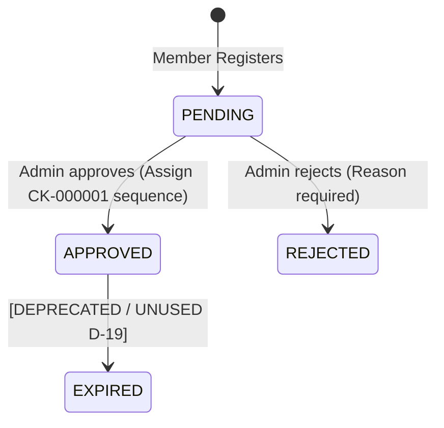

- **Transitions:**
  | From | To | Guard / Prerequisite | Actor | Side Effects |
  |---|---|---|---|---|
  | `PENDING` | `APPROVED` | Profile essentials complete, user is active, no existing membership | Staff with `MEMBERS_APPROVE` | Generate `CK-000001` member number from sequence, record `approvedAt`, `approvedBy`, send approval notification. |
  | `PENDING` | `REJECTED` | Rejection reason supplied | Staff with `MEMBERS_APPROVE` | Record `rejectionReason`, notify applicant. |
  | `APPROVED` | `EXPIRED` | **Disabled** (D-19): Membership expiry has no behaviour in this build. | None | None |

---

### 2.1A Profile Change Request (`ProfileChangeStatus`) — P3-02B

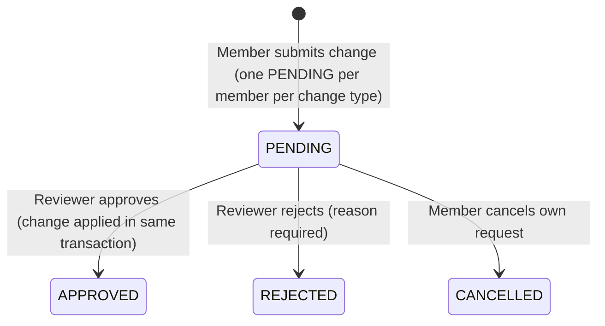

- **Change types:** `PRIMARY_BANK` (switch default payout account), `BANK_DETAILS` (replace bank/account number of an existing account; resolved server-side), `NEXT_OF_KIN`.
- **Concurrency:** every submission, approval, rejection and cancellation runs in one transaction that first takes `lockMembers(tx, [memberId])`, then moves the status with a conditional `updateMany({ where: { id, status: 'PENDING' } })` that must affect exactly one row (`STALE_STATE` otherwise). The audit event is written in the same transaction.
- **Transitions:**
  | From | To | Guard / Prerequisite | Actor | Side Effects |
  |---|---|---|---|---|
  | — | `PENDING` | Actor is the member (role `USER`); no other `PENDING` request of the same type; payload validated for its type | Member | Snapshot previous value; audit `PROFILE_CHANGE.SUBMITTED`. |
  | `PENDING` | `APPROVED` | Reviewer differs from the member; payload re-validated; target account still belongs to member, is verified and not registered by another active member (A-22) | Staff with `PROFILE_CHANGES_REVIEW` | Apply the change (exactly one primary account is kept); audit `PROFILE_CHANGE.APPROVED`. |
  | `PENDING` | `REJECTED` | Reason (≥ 3 chars) | Staff with `PROFILE_CHANGES_REVIEW` | Active values unchanged; audit `PROFILE_CHANGE.REJECTED`. |
  | `PENDING` | `CANCELLED` | Request belongs to the actor | Member | Audit `PROFILE_CHANGE.CANCELLED`. |

---

### 2.2 Payment Submission (`PaymentSubmissionStatus`)

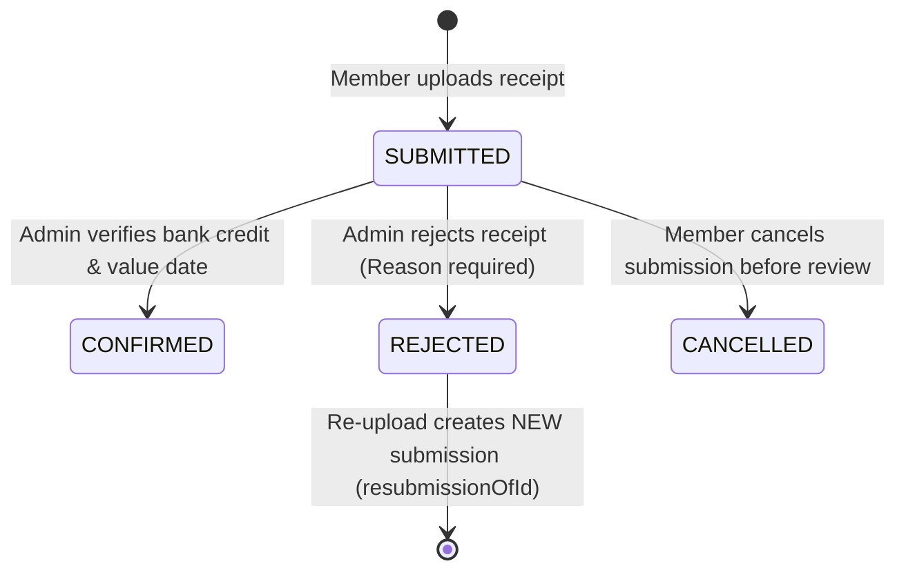

- **Transitions:**
  | From | To | Guard / Prerequisite | Actor | Side Effects |
  |---|---|---|---|---|
  | `SUBMITTED` | `CONFIRMED` | Money verified in bank statement; value date verified; no duplicate file hash / bank ref | Staff with review permission | Create `Payment` record; create `PaymentAllocation` rows; post double-entry journal; invoke `recalculateLateness()`. |
  | `SUBMITTED` | `REJECTED` | Reason required; receipt preserved | Staff with review permission | Remove review shield; trigger catch-up penalty calculation; notify member to re-upload. |
  | `SUBMITTED` | `CANCELLED` | Submission still in `SUBMITTED` state | Submitting Member | Drop review shield; notify staff review queue. |

---

### 2.3 Payment Record Lifecycle (`PaymentStatus`)

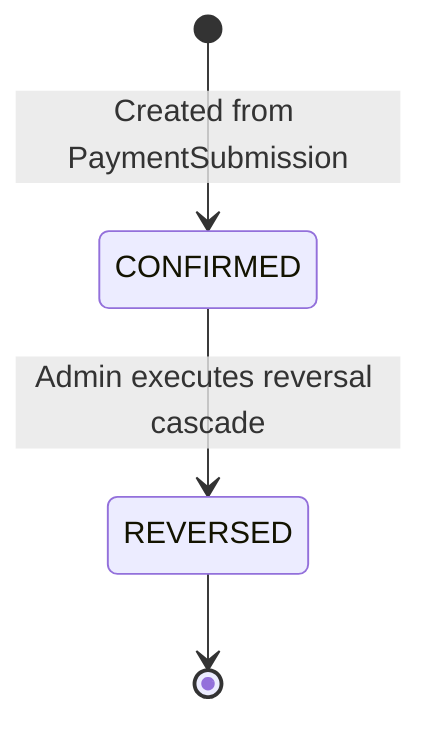

- **Transitions:**
  | From | To | Guard / Prerequisite | Actor | Side Effects |
  |---|---|---|---|---|
  | `CONFIRMED` | `REVERSED` | Reason required; reversal > 30 days or high threshold requires `OWNER` (A-13) | Staff with `PAYMENTS_REVERSE` or `OWNER` | Reverse allocations (newest first); post reversing journal entries; deduct wallet or create `REVERSAL_SHORTFALL_RECEIVABLE`; reopen obligations; void savings lots; recalculate lateness; recompute capacity. |

---

### 2.4 Savings Plan Lifecycle (`SavingsStatus`)

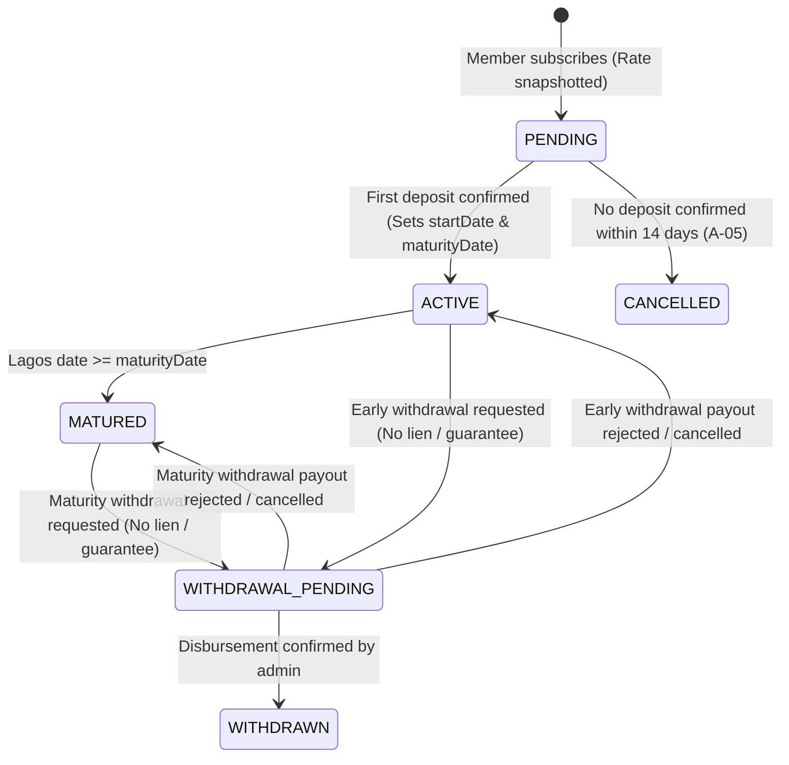

- **Transitions:**
  | From | To | Guard / Prerequisite | Actor | Side Effects |
  |---|---|---|---|---|
  | `PENDING` | `ACTIVE` | First deposit confirmed | System (Payment Confirm) | `startDate` = value date; `maturityDate` = `addMonthsClamped(startDate, durationMonths)`; generate schedule for regular savings; create `SavingsLot`. Only one first-deposit receipt may be `SUBMITTED` at a time. |
  | `PENDING` | `CANCELLED` | More than `savingsFirstDepositWindowDays` (14, A-05) Lagos days since subscription and no receipt `SUBMITTED` | Job `runSavingsExpiryJob` (`lib/jobs/savings-expiry.job.ts`) | `cancelledAt`, reason; audit `SAVINGS.PLAN_EXPIRED`; member notified after commit. |
  | `ACTIVE` | `MATURED` | Lagos date >= `maturityDate` | Job `runSavingsMaturityJob` (`lib/jobs/maturity.job.ts`), or inline when the member requests a withdrawal | Accrue up to maturity first; `maturedAt`; audit; notify. No rollover (A-08). |
  | `ACTIVE` / `MATURED` | `WITHDRAWAL_PENDING` | No own loan (`FULL` lien, A-04); principal ≤ unencumbered savings (guarantee reservations); no other withdrawal pending | Member | Kind `EARLY` (before maturity, interest 0) or `MATURITY` (principal + active accruals); amounts frozen on the plan; `Disbursement` (`SAVINGS_PAYOUT`, `REQUESTED`) to the member's primary bank account. Principal leaves lending/guarantee capacity (only `ACTIVE`/`MATURED` count). |
  | `WITHDRAWAL_PENDING` | `WITHDRAWN` | Disbursement `APPROVED` (staff `SAVINGS_PAYOUTS_MANAGE`), then payout confirmed with evidence, value date and bank reference by a different `SAVINGS_PAYOUTS_MANAGE` staff member when two exist (A-19); amounts unchanged since the request | Staff with `SAVINGS_PAYOUTS_MANAGE` (OQ-11) | Early: reverse every active accrual (lots `EARLY_WITHDRAWAL`), post Dr principal / Cr cash. Maturity: Dr principal + interest payable / Cr cash. Disbursement `PAID`; paid to the member's current primary account (approved bank-detail change, P3-02B). |
  | `WITHDRAWAL_PENDING` | `ACTIVE` / `MATURED` | Member cancels (disbursement `REQUESTED` only) or staff reject (`REQUESTED`/`APPROVED`) with a reason | Member / Staff with `SAVINGS_PAYOUTS_MANAGE` | Disbursement `CANCELLED`; plan returns to `MATURED` if the maturity date has passed, else `ACTIVE`; accrual resumes. |

---

### 2.5 Loan Lifecycle (`LoanStatus`)

As implemented in P3-04 (`lib/services/loans.service.ts`). Every transition runs in one transaction that
first takes `lockMembers` on the borrower and the guarantor, then uses `transition()` (conditional update,
`STALE_STATE` on a race).

```mermaid
stateDiagram-v2
    [*] --> PENDING: Member applies (rate/penalty/cap snapshotted; guarantor asked; fee assessed if > 0)
    PENDING --> APPROVED: Admin approves the requested amount and term
    PENDING --> AWAITING_RECONSENT: Admin approves a lower amount or another term (D-10)
    PENDING --> REJECTED: Admin rejects (reason required)
    PENDING --> CANCELLED: Member withdraws the application
    APPROVED --> ACCEPTED: Borrower accepts the offer (PDF evidence)
    AWAITING_RECONSENT --> ACCEPTED: Borrower accepts AND guarantor re-consents (either order)
    APPROVED --> DECLINED: Borrower declines (reason required)
    AWAITING_RECONSENT --> DECLINED: Borrower or guarantor declines the revised terms
    APPROVED --> EXPIRED: Offer not accepted by offerExpiresAt (job)
    AWAITING_RECONSENT --> EXPIRED: Offer not accepted by offerExpiresAt (job)
    APPROVED --> CANCELLED: Guarantor withdraws consent before disbursement
    AWAITING_RECONSENT --> CANCELLED: Guarantor withdraws consent before disbursement
    ACCEPTED --> CANCELLED: Guarantor withdraws consent before disbursement
    ACCEPTED --> ACTIVE: Staff record the disbursement (dual control A-19)
    ACTIVE --> OVERDUE: An unpaid, unshielded instalment reaches due date + 8
    OVERDUE --> ACTIVE: Overdue amounts brought current
    ACTIVE --> COMPLETED: Every instalment's principal, interest and net penalties settled
    OVERDUE --> COMPLETED: Settled (receipt, wallet or early settlement)
    OVERDUE --> DEFAULTED: Recovery (P3-06B)
    DEFAULTED --> COMPLETED: Fully recovered
```

- **Transitions:**
  | From | To | Guard / Prerequisite | Actor | Side Effects |
  |---|---|---|---|---|
  | — | `PENDING` | Active member (not staff), product eligibility, active term rate for the term, named active guarantor whose free capacity covers the support needed (§2.1) | Member | Snapshot rate, penalty %, cap, rate version; `GuaranteeReservation` `PENDING`; `FeeAssessment` if fee > 0. |
  | `PENDING` | `APPROVED` / `AWAITING_RECONSENT` | Guarantee `CONSENTED` for the current `termsVersion`; fee `PAID`/`WAIVED`; amount ≤ requested and ≤ consented; capacity re-checked inside the lock | `LOANS_REVIEW` | Offer (`BorrowerOfferAcceptance` `PENDING`), `offerExpiresAt`; on changed terms bump `termsVersion`, re-snapshot the new term's rate, guarantee → `AWAITING_RECONSENT` holding the new support amount. |
  | `PENDING` | `REJECTED` / `CANCELLED` | Reason (reject) / own application (cancel) | `LOANS_REVIEW` / Member | Release guarantees; waive an unpaid fee (a paid fee is kept, OQ-03); re-allocate reservations. |
  | `APPROVED` | `ACCEPTED` | Offer open, not expired, `termsVersion` matches | Borrower | Evidence PDF. |
  | `AWAITING_RECONSENT` | `ACCEPTED` | Borrower accepted **and** guarantee `CONSENTED` at the new `termsVersion` | Borrower / Guarantor | Evidence PDFs for both decisions. |
  | `APPROVED`/`AWAITING_RECONSENT` | `DECLINED` / `EXPIRED` | Borrower declines, guarantor declines re-consent, or `offerExpiresAt` passed | Borrower / Guarantor / Job | Release guarantees; waive an unpaid fee. |
  | `ACCEPTED` | `ACTIVE` | Offer accepted and guarantee consented at the same `termsVersion`; amount = approved; value date ≤ today and ≥ approval date; bank reference; evidence file; disburser ≠ approver when two eligible staff exist | `LOANS_DISBURSE` | `Disbursement` (`PAID`), journal `LOAN_RECEIVABLE_PRINCIPAL` / `COOPERATIVE_CASH` (key `loan-disbursement:{loanId}`), instalments from `addMonthsClamped(valueDate, k)`. Idempotent replay. |
  | `ACTIVE`/`OVERDUE` | `ACTIVE`/`OVERDUE`/`COMPLETED` | Derived by `refreshLoanAfterPayment()` after every confirmation, rejection and wallet payment | System | Instalment statuses re-derived; completion releases guarantees (the own-savings lock is derived from the status); reservations re-allocated (§2.1). |

- The own-savings lock (D-02) applies in `APPROVED`, `AWAITING_RECONSENT`, `ACCEPTED`, `ACTIVE`, `OVERDUE`,
  `DEFAULTED` (and legacy `DISBURSED`).

---

### 2.6 Obligation Periods (`SavingsPeriod`, `LoanInstalment`, `EAjoContributionPeriod`)

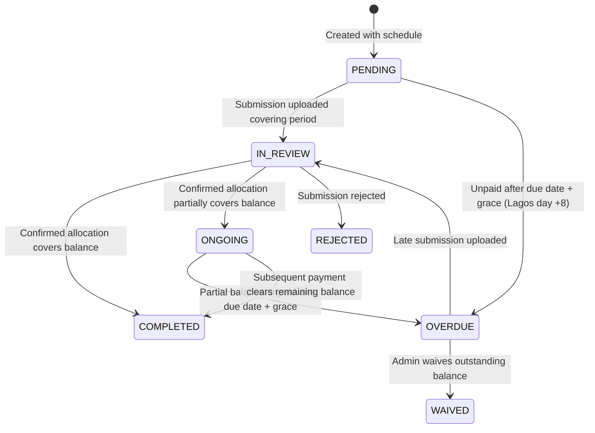

- **Key Transition Rules:**
  - Statuses are **strictly derived** from active payment allocations and current Lagos date.
  - Review shield: While an active submission is `IN_REVIEW`, the period displays "Payment Under Review" and cannot transition to `OVERDUE`.
  - For regular savings, transitioning past Day +8 with an unpaid balance sets `interestForfeited = true` for that period only.
  - **Savings (P3-03):** status precedence `COMPLETED` > `IN_REVIEW` > `OVERDUE` (due date passed) > `REJECTED` > `ONGOING` > `PENDING`, recomputed on submission, confirmation, rejection and by `runSavingsForfeitureJob`. Forfeiture is evaluated from the allocations' **value dates** at the end of day +7; a `SUBMITTED` receipt with `paidOn` ≤ day +7 shields it (A-11) and the rejection triggers the catch-up. Forfeiting marks the period's lots non-interest-bearing and reverses their accruals; a value-date correction restores them and re-posts the reversed accruals back-dated to their original dates (OQ-12).

---

### 2.7 Guarantor Request & Reservation Lifecycle

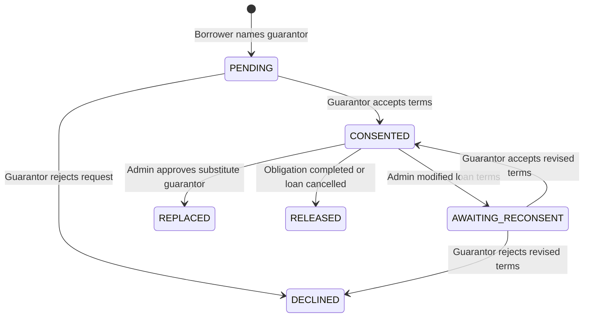

- **Reservation Invariants:**
  - `GuaranteeReservation` is created immediately upon `CONSENTED`.
  - Amount reserved = `max(0, applicantExposure - borrowerStandaloneLimit)`.
  - Reserved amount reduces guarantor's free guarantee capacity.
  - Released only upon: loan full settlement, e-ajo completion, replacement guarantor reservation activation, or application cancellation.
  - P3-04: a guarantee in `AWAITING_RECONSENT` keeps holding its (re-sized) reservation until the guarantor decides; consent and withdrawal are only possible while the loan is not yet disbursed.

---

### 2.8 E-Ajo Group & Member Lifecycle (as implemented in P3-05)

```mermaid
stateDiagram-v2
    [*] --> PENDING: Admin creates group (every slot penalty set)
    PENDING --> ACTIVE: Admin activates (roster, amounts & terms locked; periods + payouts created)
    ACTIVE --> COMPLETED: Every participant COMPLETED or CANCELLED

    state "EAjoMember Lifecycle" as MemberState {
        [*] --> M_PENDING: Member (or staff on their behalf) picks a slot and names a guarantor
        M_PENDING --> M_APPROVED: Admin approves (guarantor CONSENTED, capacity rechecked)
        M_PENDING --> M_REJECTED: Admin rejects with reason, or group activated before approval
        M_PENDING --> M_CANCELLED: Admin cancels before activation
        M_APPROVED --> M_ACTIVE: Group activated
        M_APPROVED --> M_CANCELLED: Admin cancels before activation
        M_ACTIVE --> M_CANCELLED: Admin cancels BEFORE payout approval (contributions → wallet, unpaid late fees deducted if the admin chooses)
        M_ACTIVE --> M_COMPLETED: Payout PAID and every contribution and assessed penalty settled
    }
```

- **Guards & locking:** every roster change takes the group advisory lock (`eajo-group:{id}`) then the member locks (`lockMembers`), and uses `transition()` (conditional `updateMany`). `maxMembersPerSlot` counts PENDING, APPROVED, ACTIVE and COMPLETED participants, so concurrent joins cannot overfill a slot.
- **Rules:**
  - Cancellation is refused once the payout is APPROVED or PAID. While late fees are unpaid it is refused unless the admin chooses to deduct them from the contributions held; the remainder is refunded to the wallet (OQ-13).
  - The early-slot penalty, late-penalty % and cap are snapshotted on the participant at activation.
  - Guarantee reservation: `c × (N − s)` until the payout is PAID, then `min(advance, unpaid contributions)`; RELEASED on rejection, cancellation or completion.

---

### 2.9 E-Ajo Payout Lifecycle (`EAjoPayoutStatus`, as implemented in P3-05)

```mermaid
stateDiagram-v2
    [*] --> NOT_ELIGIBLE: Created at group activation
    NOT_ELIGIBLE --> ELIGIBLE: Payout month reached, months 1..s settled (job or after a confirmation)
    ELIGIBLE --> NOT_ELIGIBLE: A reversal or new penalty undoes the conditions (re-derived)
    NOT_ELIGIBLE --> HELD: Admin hold with reason
    ELIGIBLE --> HELD: Admin hold with reason
    HELD --> NOT_ELIGIBLE: Hold released, then eligibility re-derived immediately
    ELIGIBLE --> APPROVED: EAJO_PAYOUTS_MANAGE approves (eligibility rechecked; EAJO_PAYOUT disbursement created)
    APPROVED --> PAID: Different staff member records value date, bank reference and evidence (dual control A-19)
    NOT_ELIGIBLE --> CANCELLED: Participant cancelled
    ELIGIBLE --> CANCELLED: Participant cancelled
    HELD --> CANCELLED: Participant cancelled
    APPROVED --> FAILED: (P3-09 failed-payout flow; enum value added in P3-05)
    FAILED --> APPROVED: (P3-09)
```

- An EAJO_PAYOUT `Disbursement` is never paid through the generic `disbursePayment` (it refuses with `USE_EAJO_PAYOUT_FLOW`); `recordEAjoPayoutPaid` posts the §2.12/C4 journal and marks the disbursement PAID.

---

### 2.10 Recovery Case Lifecycle (`RecoveryCaseStatus`)

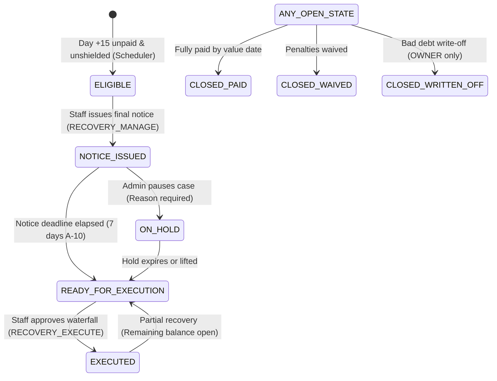

- **Waterfall Order:**
  1. Debtor Wallet Credit
  2. Debtor Confirmed Savings Principal (Lien / locked lots)
  3. Guarantor Reserved Savings (Requires explicit checkbox on approval screen)

---

### 2.11 Member Settlement Case Lifecycle (`SettlementCaseStatus`)

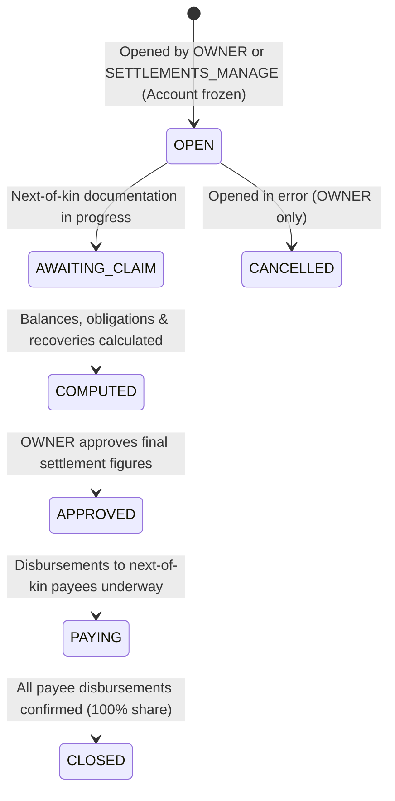

- **Invariants:**
  - Immediate login freeze on opening.
  - Late penalty accrual stops as of recorded death/exit date.
  - Payee percentage shares must sum to exactly `100.00%`.
