# Domain State Machines & Lifecycle Transitions

This document defines every stateful lifecycle enum, its allowed state transitions, guarding conditions, actors, and atomic side effects for the Crystal Kairos system, extending **§4.1** of the Implementation Guide.

> [!IMPORTANT]
> **Engineering Invariant:**
> Generic admin forms and client mutations must **never** set arbitrary enum statuses. Every transition must be executed through a dedicated domain service method backed by a concurrency-safe atomic conditional update (`updateMany` with expected status or PostgreSQL advisory lock) verifying that exactly one row transitioned.

---

## 1. Summary of State Machines

| Model | State Enum Field | Terminal States | Concurrency Mechanism |
|---|---|---|---|
| `Membership` | `status` | `APPROVED`, `REJECTED`, `EXPIRED` | Conditional update (`count === 1`) |
| `ProfileChangeRequest` | `status` | `APPROVED`, `REJECTED` | Advisory lock on `memberId` |
| `PaymentSubmission` | `status` | `CONFIRMED`, `REJECTED`, `CANCELLED` | Conditional update (`count === 1`) |
| `Payment` | `status` | `REVERSED` | Advisory lock on `paymentId` |
| `Savings` (Plan) | `status` | `WITHDRAWN`, `CANCELLED` | Advisory lock on `savingsId` |
| `SavingsPeriod` | `status` | `COMPLETED`, `WAIVED` | Derived from payment allocations |
| `Loan` | `status` | `COMPLETED`, `DEFAULTED`, `REJECTED`, `CANCELLED` | Conditional update + Advisory lock |
| `LoanInstalment` | `status` | `COMPLETED`, `WAIVED` | Derived from payment allocations |
| `GuaranteeRequest` | `status` | `DECLINED`, `RELEASED`, `REPLACED`, `CANCELLED` | Advisory lock on `guarantorId` |
| `GuaranteeReservation` | `status` | `RELEASED`, `CONSUMED` | Advisory lock on `guarantorId` |
| `EAjoGroup` | `status` | `COMPLETED`, `CANCELLED`, `REJECTED` | Conditional update (`count === 1`) |
| `EAjoMember` | `status` | `COMPLETED`, `CANCELLED`, `REJECTED` | Advisory lock on `groupId` |
| `EAjoContributionPeriod` | `status` | `COMPLETED`, `WAIVED` | Derived from payment allocations |
| `EAjoPayout` | `status` | `PAID` | Dual-control conditional update |
| `Disbursement` | `status` | `PAID`, `CANCELLED`, `FAILED` | Advisory lock on `disbursementId` |
| `WalletWithdrawal` | `status` | `PAID`, `REJECTED`, `CANCELLED`, `FAILED` | Advisory lock on `memberId` |
| `RecoveryCase` | `status` | `CLOSED_PAID`, `CLOSED_WAIVED`, `CLOSED_WRITTEN_OFF` | Conditional update on `caseId` |
| `UnidentifiedDeposit` | `status` | `ASSIGNED`, `REFUNDED` | Advisory lock on deposit reference |
| `MemberSettlementCase` | `status` | `CLOSED`, `CANCELLED` | Advisory lock on `memberId` |
| `PolicyUpdateDraft` | `status` | `SENT`, `DISCARDED` | Conditional update (`count === 1`) |
| `JobRun` | `status` | `SUCCEEDED`, `FAILED` | Advisory lease lock |

---

## 2. Detailed State Machine Catalog

### 2.1 Membership Lifecycle (`MembershipStatus`)

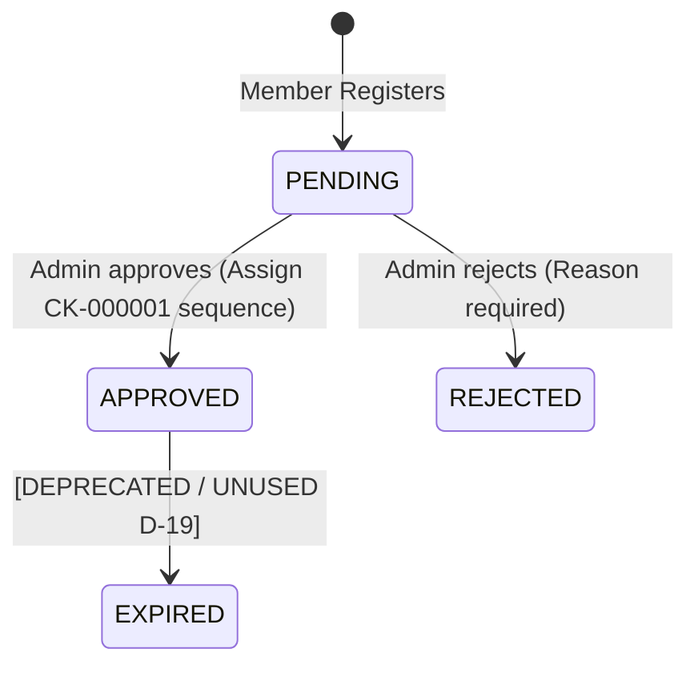

- **Transitions:**
  | From | To | Guard / Prerequisite | Actor | Side Effects |
  |---|---|---|---|---|
  | `PENDING` | `APPROVED` | Profile essentials complete, user is active, no existing membership | Staff with `MEMBERS_APPROVE` | Generate `CK-000001` member number from sequence, record `approvedAt`, `approvedBy`, send approval notification. |
  | `PENDING` | `REJECTED` | Rejection reason supplied | Staff with `MEMBERS_APPROVE` | Record `rejectionReason`, notify applicant. |
  | `APPROVED` | `EXPIRED` | **Disabled** (D-19): Membership expiry has no behaviour in this build. | None | None |

---

### 2.2 Payment Submission (`PaymentSubmissionStatus`)

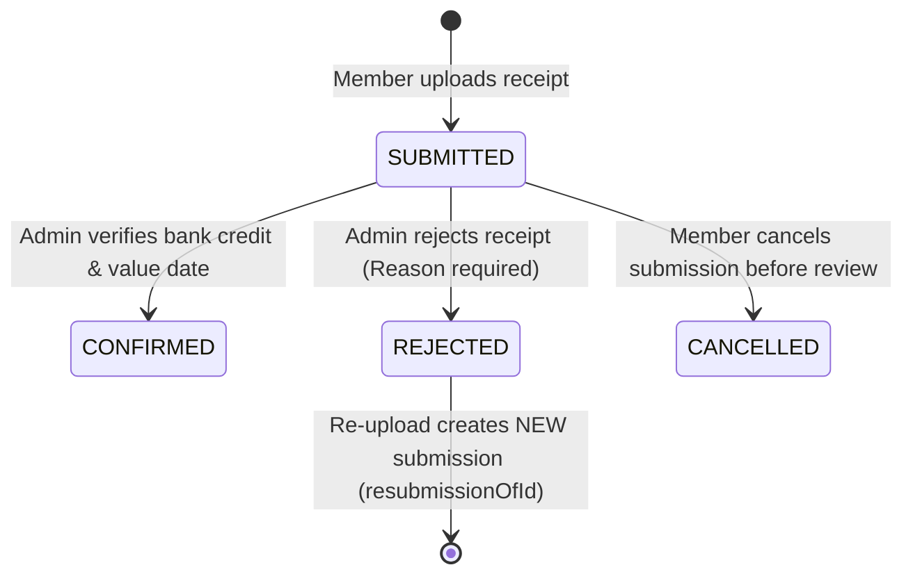

- **Transitions:**
  | From | To | Guard / Prerequisite | Actor | Side Effects |
  |---|---|---|---|---|
  | `SUBMITTED` | `CONFIRMED` | Money verified in bank statement; value date verified; no duplicate file hash / bank ref | Staff with review permission | Create `Payment` record; create `PaymentAllocation` rows; post double-entry journal; invoke `recalculateLateness()`. |
  | `SUBMITTED` | `REJECTED` | Reason required; receipt preserved | Staff with review permission | Remove review shield; trigger catch-up penalty calculation; notify member to re-upload. |
  | `SUBMITTED` | `CANCELLED` | Submission still in `SUBMITTED` state | Submitting Member | Drop review shield; notify staff review queue. |

---

### 2.3 Payment Record Lifecycle (`PaymentStatus`)

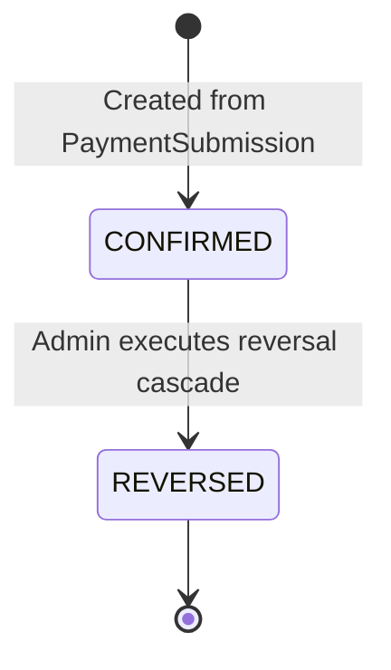

- **Transitions:**
  | From | To | Guard / Prerequisite | Actor | Side Effects |
  |---|---|---|---|---|
  | `CONFIRMED` | `REVERSED` | Reason required; reversal > 30 days or high threshold requires `OWNER` (A-13) | Staff with `PAYMENTS_REVERSE` or `OWNER` | Reverse allocations (newest first); post reversing journal entries; deduct wallet or create `REVERSAL_SHORTFALL_RECEIVABLE`; reopen obligations; void savings lots; recalculate lateness; recompute capacity. |

---

### 2.4 Savings Plan Lifecycle (`SavingsStatus`)

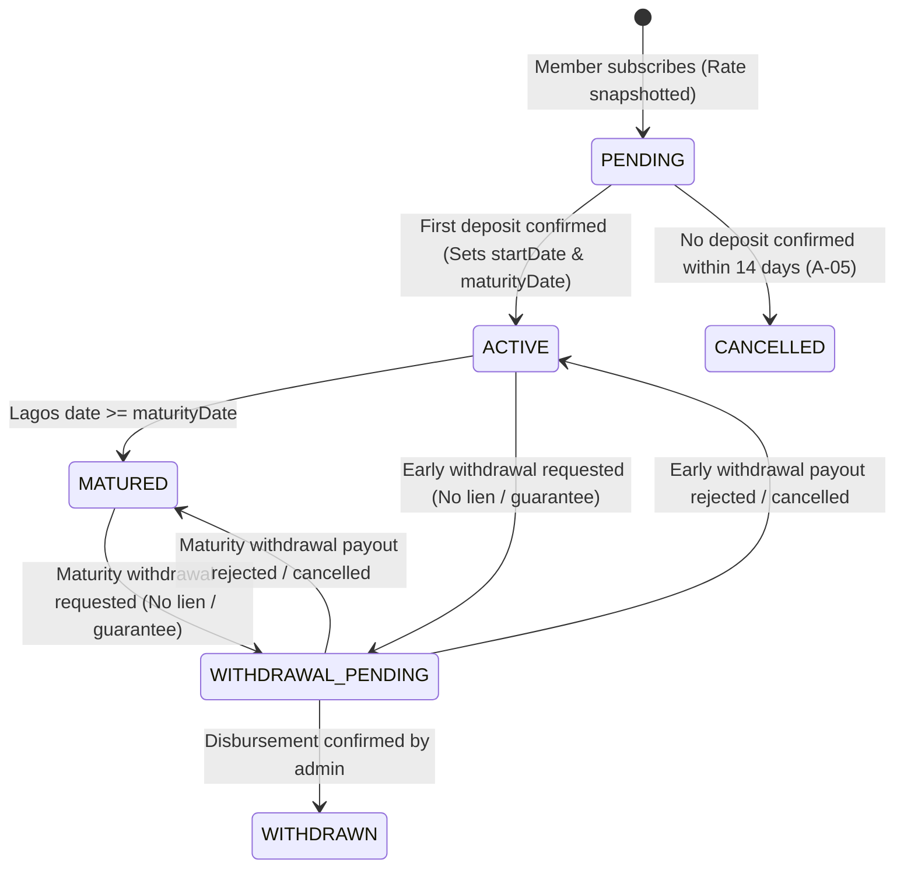

- **Transitions:**
  | From | To | Guard / Prerequisite | Actor | Side Effects |
  |---|---|---|---|---|
  | `PENDING` | `ACTIVE` | First deposit confirmed | System (Payment Confirm) | `startDate` = value date; `maturityDate` = `addMonthsClamped(startDate, durationMonths)`; generate schedule for regular savings; create `SavingsLot`. |
  | `PENDING` | `CANCELLED` | Expiry window elapsed (14 days, A-05) | Scheduled Job (`savings-expiry`) | Close plan; audit log. |
  | `ACTIVE` | `MATURED` | Today (Lagos) >= `maturityDate` | Scheduled Job (`maturity`) | Mark plan matured; calculate final payable interest; notify member. |
  | `ACTIVE` / `MATURED` | `WITHDRAWAL_PENDING` | No own-loan lock (`ownSavingsLienMode`); no active guarantee reservation; principal unencumbered | Member | Freeze requested principal; exclude from lending/guarantee capacity; create `Disbursement` request. |
  | `WITHDRAWAL_PENDING` | `WITHDRAWN` | Payout disbursement confirmed | Staff with `LOANS_DISBURSE` / Payout | If early withdrawal: forfeit accrued interest (reverse journal lines); post principal payout journal; close plan. |
  | `WITHDRAWAL_PENDING` | `ACTIVE` / `MATURED` | Payout failed or rejected by admin | Staff / Payout failure | Unfreeze principal; restore capacity; return to previous state. |

---

### 2.5 Loan Lifecycle (`LoanStatus`)

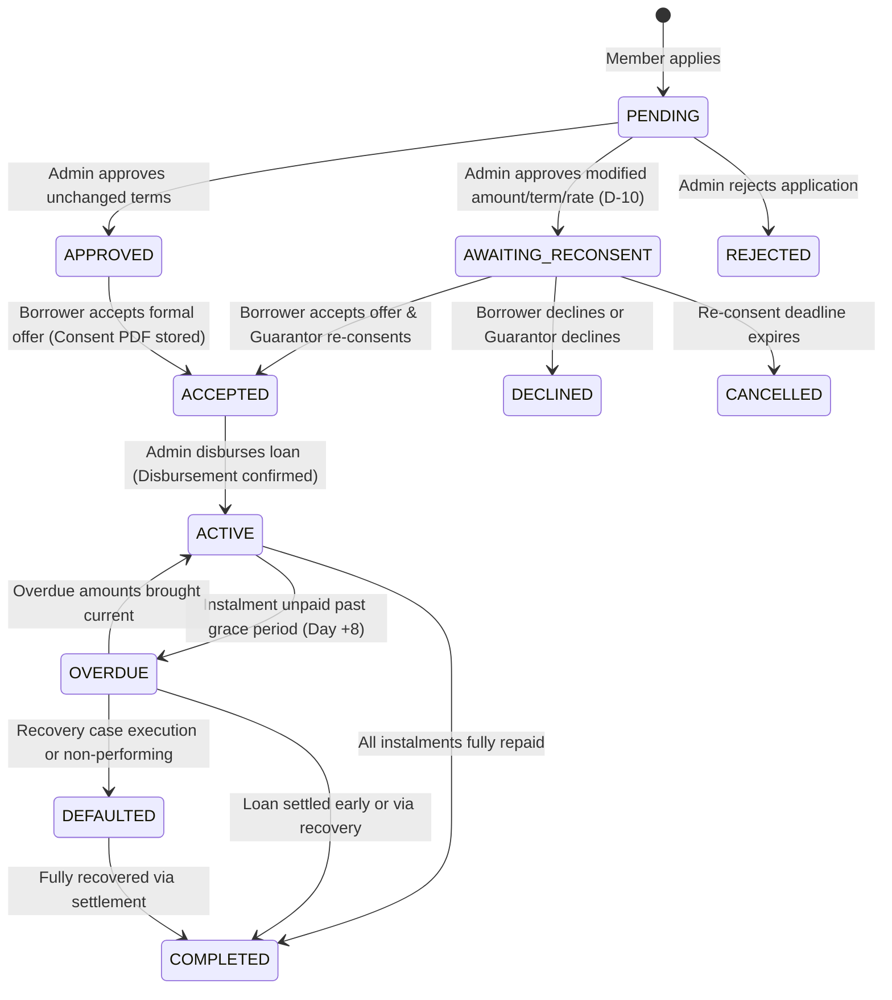

- **Transitions:**
  | From | To | Guard / Prerequisite | Actor | Side Effects |
  |---|---|---|---|---|
  | `PENDING` | `APPROVED` | Borrower within capacity; guarantor consented & reserved; application fee paid (if applicable) | Staff with `LOANS_REVIEW` | Snapshot agreed rate, duration, penalty cap; create borrower offer. |
  | `PENDING` | `AWAITING_RECONSENT` | Approved terms differ from requested | Staff with `LOANS_REVIEW` | Hold provisional reservation; notify borrower and guarantor to re-consent. |
  | `AWAITING_RECONSENT` | `ACCEPTED` | Both borrower and guarantor accept revised terms | Borrower & Guarantor | Re-create guarantee reservation atomically; generate signed terms PDF. |
  | `APPROVED` | `ACCEPTED` | Borrower accepts terms & schedule | Borrower | Store accepted terms PDF evidence. |
  | `ACCEPTED` | `ACTIVE` | Disbursed by different staff user (dual control A-19); disbursement value date recorded | Staff with `LOANS_DISBURSE` | Set `disbursementValueDate`; generate `LoanInstalment` rows via `addMonthsClamped`; activate own-savings lock (`FULL`); post loan receivable journal. |
  | `ACTIVE` | `OVERDUE` | Today >= dueDate + 8 (unshielded) | Scheduled Job / Lateness | Flag loan overdue; begin daily penalty accrual. |
  | `ACTIVE` / `OVERDUE` | `COMPLETED` | Balance = 0 (principal, interest, penalties) | System (Payment / Wallet) | Release own-savings lock; release guarantor reservation atomically; audit log. |

---

### 2.6 Obligation Periods (`SavingsPeriod`, `LoanInstalment`, `EAjoContributionPeriod`)

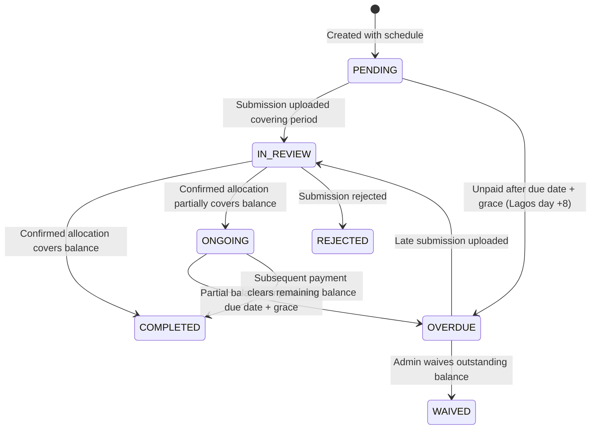

- **Key Transition Rules:**
  - Statuses are **strictly derived** from active payment allocations and current Lagos date.
  - Review shield: While an active submission is `IN_REVIEW`, the period displays "Payment Under Review" and cannot transition to `OVERDUE`.
  - For regular savings, transitioning past Day +8 with an unpaid balance sets `interestForfeited = true` for that period only.

---

### 2.7 Guarantor Request & Reservation Lifecycle

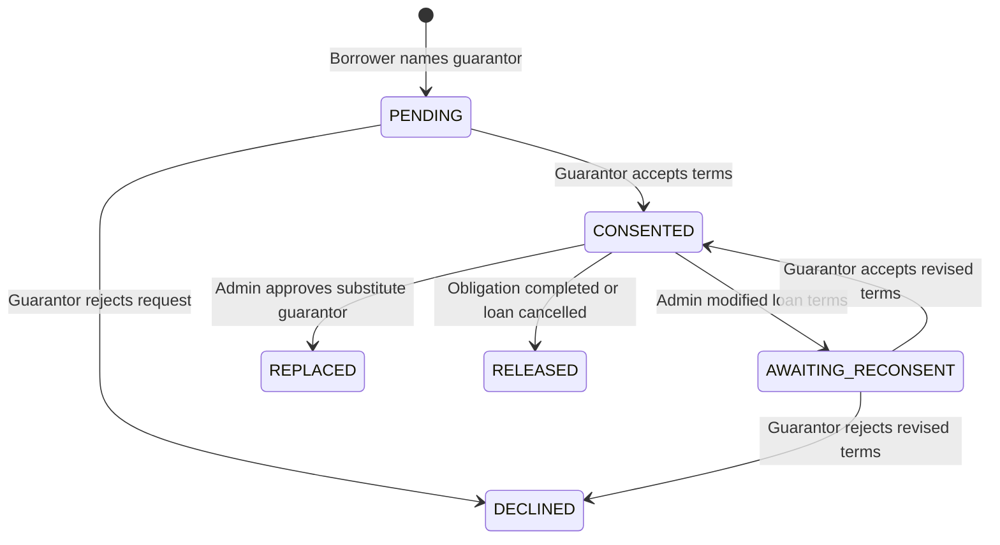

- **Reservation Invariants:**
  - `GuaranteeReservation` is created immediately upon `CONSENTED`.
  - Amount reserved = `max(0, applicantExposure - borrowerStandaloneLimit)`.
  - Reserved amount reduces guarantor's free guarantee capacity.
  - Released only upon: loan full settlement, e-ajo completion, replacement guarantor reservation activation, or application cancellation.

---

### 2.8 E-Ajo Group & Member Lifecycle

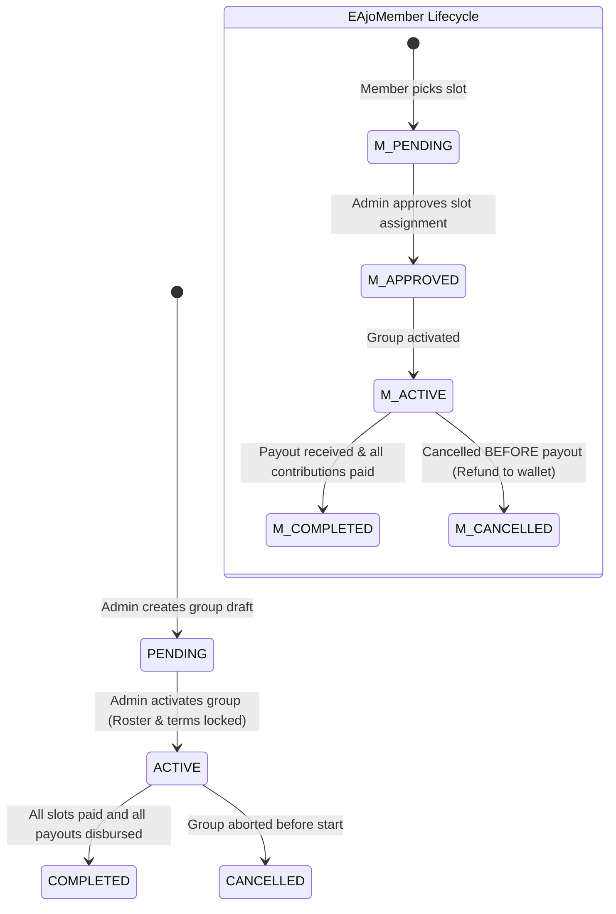

- **Rules:**
  - Cancellation after payout is strictly forbidden.
  - Early-slot penalty is fixed at activation from `EAjoSlotPolicy`.

---

### 2.9 E-Ajo Payout Lifecycle (`EAjoPayoutStatus`)

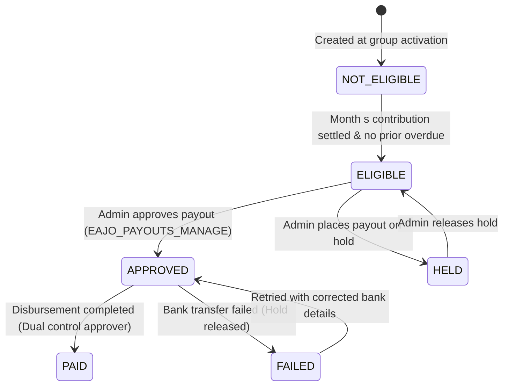

---

### 2.10 Recovery Case Lifecycle (`RecoveryCaseStatus`)

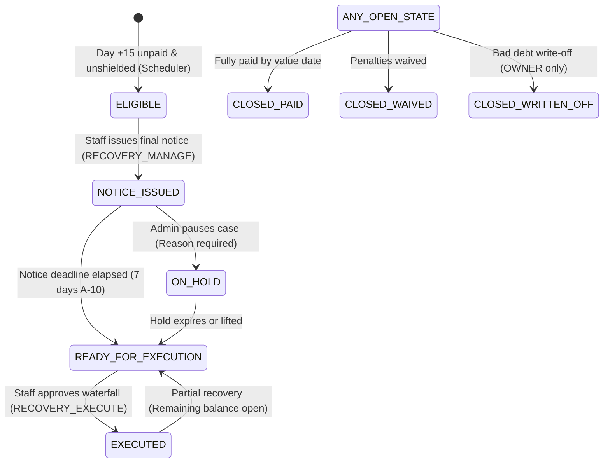

- **Waterfall Order:**
  1. Debtor Wallet Credit
  2. Debtor Confirmed Savings Principal (Lien / locked lots)
  3. Guarantor Reserved Savings (Requires explicit checkbox on approval screen)

---

### 2.11 Member Settlement Case Lifecycle (`SettlementCaseStatus`)

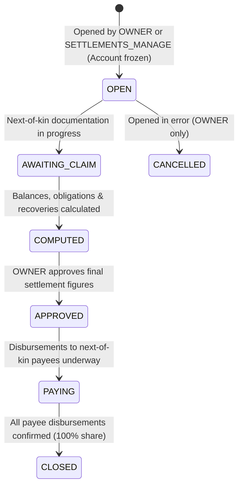

- **Invariants:**
  - Immediate login freeze on opening.
  - Late penalty accrual stops as of recorded death/exit date.
  - Payee percentage shares must sum to exactly `100.00%`.
